# Circini Migration Agent — Architecture Document

> **Version**: 1.0 | **Date**: April 14, 2026  
> **Domain**: https://migration.callsphere.tech  
> **Repository**: https://github.com/shankasf/E-Commerce-Voice-Agent.git

---

## Table of Contents

1. [Executive Summary](#1-executive-summary)  
2. [Current Architecture Overview](#2-current-architecture-overview)  
3. [System Design Flowcharts — Current](#3-system-design-flowcharts--current)  
4. [Software & Technology Stack](#4-software--technology-stack)  
5. [Data Flow](#5-data-flow)  
6. [Data at Rest / Storage](#6-data-at-rest--storage)  
7. [Hosting & Infrastructure](#7-hosting--infrastructure)  
8. [Security](#8-security)  
9. [AI Agent Design](#9-ai-agent-design)  
10. [API Surface](#10-api-surface)  
11. [Monitoring & Observability](#11-monitoring--observability)  
12. [Known Limitations](#12-known-limitations)  
13. [Scalable Architecture Plan](#13-scalable-architecture-plan)  
14. [System Design Flowcharts — Scalable](#14-system-design-flowcharts--scalable)  
15. [Migration Roadmap: Current to Scalable](#15-migration-roadmap-current-to-scalable)

---

## 1. Executive Summary

The **Circini Migration Agent** is an AI-powered assistant that generates Snowflake-compatible DBT models for contract data migrations (CLM to AMS). Users upload mapping documents, templates, and reference SQL through a ChatGPT-like interface, and the agent produces complete, validated dbt SQL models.

| Tier | Technology | Role |
|------|-----------|------|
| **Frontend** | React 18 + Vite + TypeScript | Chat UI, file upload, real-time logs |
| **Backend** | Node.js + Express + Prisma | REST API, session management, file storage |
| **AI Service** | Python FastAPI + OpenAI Agents SDK | LLM orchestration, SQL generation |

All three run as containers in a Kubernetes (K3s) cluster, fronted by Traefik with TLS.

---

## 2. Current Architecture Overview

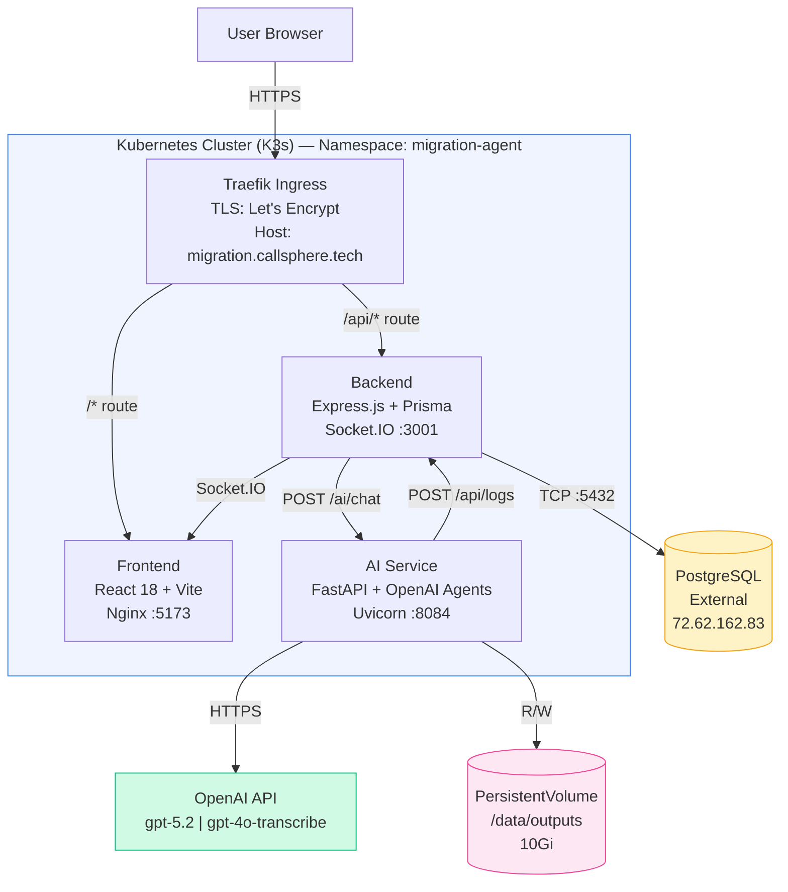

---

## 3. System Design Flowcharts — Current

### 3.1 High-Level Request Flow

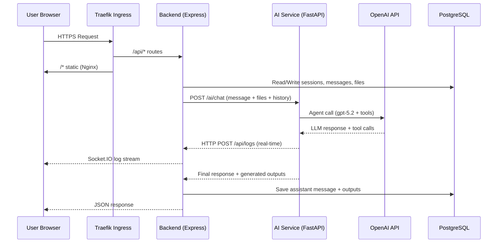

### 3.2 File Upload and Chat Message Flow

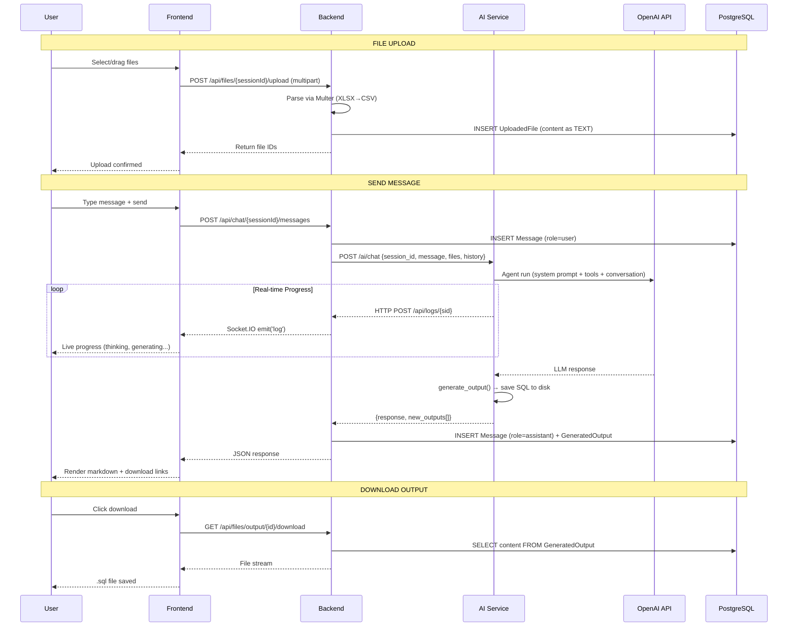

### 3.3 Speech-to-Text Flow

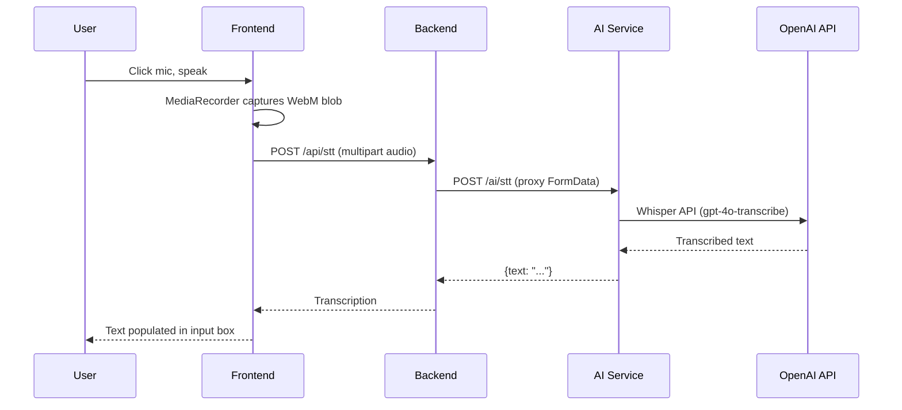

### 3.4 Real-Time Log Streaming

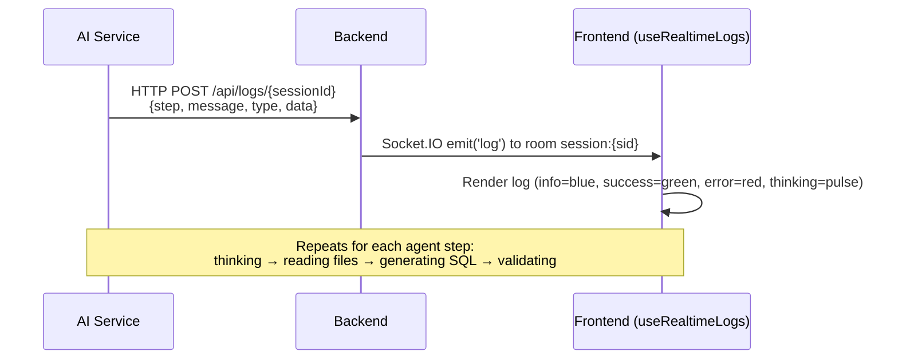

---

## 4. Software & Technology Stack

### 4.1 Frontend

| Software | Version | Purpose |
|----------|---------|---------|
| React | 18.2 | UI framework |
| Vite | 5.x | Build tool and dev server |
| TypeScript | 5.3 | Type-safe JavaScript |
| TailwindCSS | 3.4 | Utility-first CSS |
| Socket.IO Client | 4.8 | WebSocket for real-time logs |
| Axios | 1.6.5 | HTTP client |
| react-markdown | 9.0 | Markdown rendering in chat |
| react-syntax-highlighter | 15.5 | SQL/code syntax highlighting |
| lucide-react | 0.312 | Icon library |
| Nginx | alpine | Production static server |

### 4.2 Backend

| Software | Version | Purpose |
|----------|---------|---------|
| Node.js | 20 LTS | JavaScript runtime |
| Express | 4.18 | HTTP framework |
| TypeScript | 5.3 | Type safety |
| Prisma | 5.9 | ORM and migrations |
| Socket.IO | 4.8 | WebSocket server |
| Multer | 1.4 | File upload handling |
| XLSX | 0.18 | Excel file parsing |
| UUID | 9.0 | ID generation |
| Axios | 1.6 | HTTP client (to AI service) |
| cors | 2.8 | CORS middleware |

### 4.3 AI Service

| Software | Version | Purpose |
|----------|---------|---------|
| Python | 3.12 | Runtime |
| FastAPI | 0.109 | Async web framework |
| Uvicorn | 0.27 | ASGI server |
| OpenAI Agents SDK | 0.0.7 | Agent orchestration with tool use |
| Pandas | 2.1.4 | CSV/data parsing |
| HTTPX | 0.27 | Async HTTP client |
| Pydantic | 2.10 | Data validation |

### 4.4 Database and Infrastructure

| Software | Purpose |
|----------|---------|
| PostgreSQL 15+ | Relational database |
| Docker | Container runtime (multi-stage builds) |
| Kubernetes (K3s) | Container orchestration |
| Traefik | Ingress controller and reverse proxy |
| cert-manager + Let's Encrypt | Automatic TLS certificates |

### 4.5 External APIs

| Service | Model | Purpose |
|---------|-------|---------|
| OpenAI API | `gpt-5.2-2025-12-11` | Main LLM for SQL generation |
| OpenAI API | `gpt-4o-transcribe` | Speech-to-text |
| AWS SES | `us-east-1` | Email (configured, unused) |

---

## 5. Data Flow

### 5.1 Write, Process, Read Paths

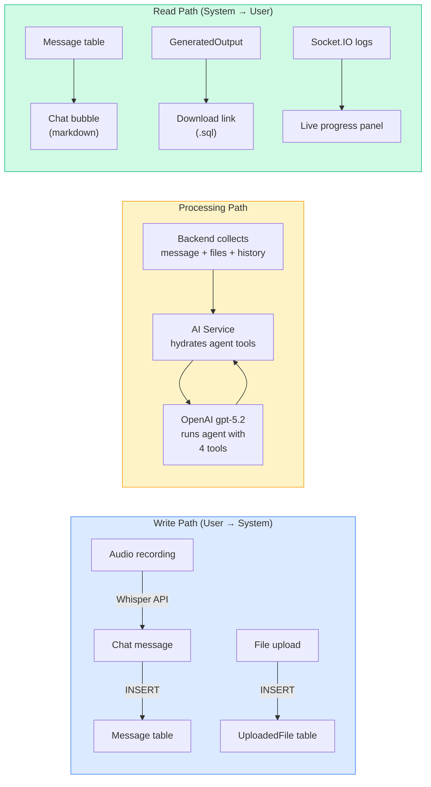

---

## 6. Data at Rest / Storage

### 6.1 PostgreSQL Database

| Table | Stores | Retention | Size |
|-------|--------|-----------|------|
| `Session` | Session metadata (id, name, timestamps) | Permanent | ~200 bytes/row |
| `Message` | Chat messages (user + assistant) | Cascade-deleted with session | 1-50 KB/row |
| `UploadedFile` | Full file content as TEXT | Cascade-deleted with session | 10 KB - 10 MB/row |
| `GeneratedOutput` | Generated SQL + metadata | Cascade-deleted with session | 5-100 KB/row |

**Constraints**: `UploadedFile` unique on `(sessionId, category)`, `GeneratedOutput` unique on `(sessionId, filename)`. All tables indexed on `sessionId`.

### 6.2 Other Storage

| Store | Location | Details |
|-------|----------|---------|
| PersistentVolume | `/data/outputs/{session_id}/{ts}/{file}` | 10Gi PVC, redundant copy of GeneratedOutput |
| In-Memory Cache | AI Service process | `session_storage` + `session_agents` — TTL 1hr, max 50 sessions |

### 6.3 Data Lifecycle

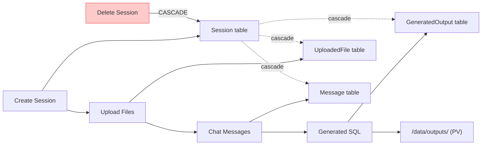

---

## 7. Hosting & Infrastructure

### 7.1 Production Environment

| Component | Details |
|-----------|---------|
| **Server** | Single-node K3s cluster (Linux/Ubuntu) |
| **Domain** | `migration.callsphere.tech` |
| **TLS** | Let's Encrypt via cert-manager (auto-renewal) |
| **Ingress** | Traefik (path-based routing) |
| **Storage** | local-path provisioner, 10Gi PVC |
| **Database** | External PostgreSQL at `72.62.162.83:5432` |

### 7.2 Kubernetes Resources

| Resource | Configuration |
|----------|--------------|
| **Namespace** | `migration-agent` |
| **Deployments** | frontend (1 replica, :5173), backend (1 replica, :3001), ai-service (1 replica, :8084) |
| **Services** | 3x ClusterIP |
| **Ingress** | `/api/*` and `/socket.io/*` → backend, `/*` → frontend |
| **PVC** | `outputs-pvc` 10Gi (local-path) |
| **ConfigMap** | `migration-agent-config` (OPENAI_MODEL, OUTPUT_DIR, AI_SERVICE_URL, CORS_ORIGIN) |
| **Secret** | `migration-agent-secret` (OPENAI_API_KEY, DATABASE_URL) |

### 7.3 Network Topology

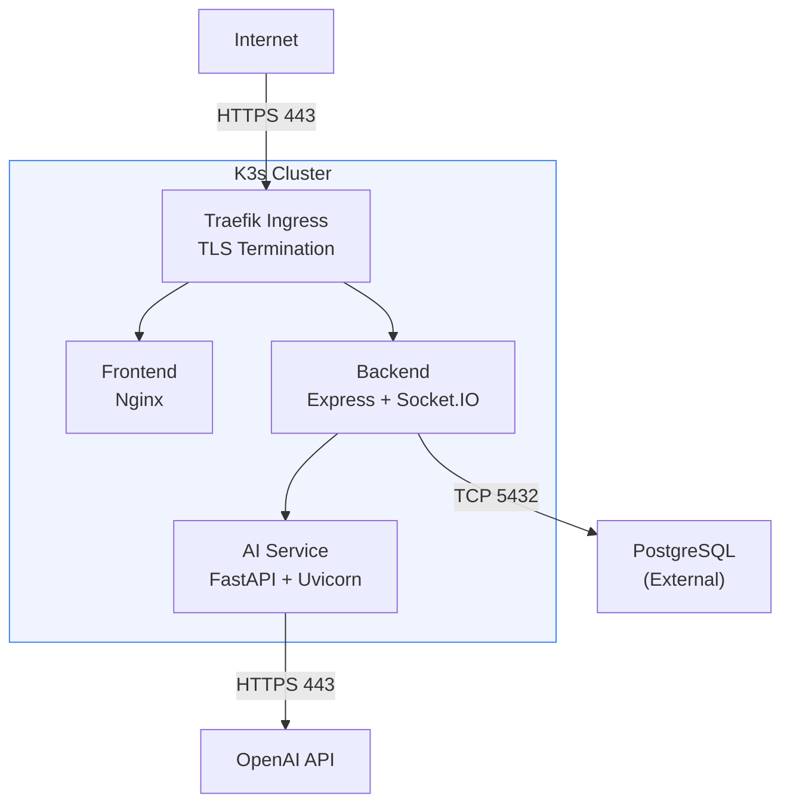

---

## 8. Security

### 8.1 Current Security Posture

| Layer | Status | Details |
|-------|--------|---------|
| Authentication | **None** | No login or API keys |
| Authorization | **None** | Any user can access any session |
| Transport Encryption | **Yes** | TLS via Let's Encrypt |
| CORS | **Configured** | Restricted to production domain |
| Secrets Management | **Partial** | K8s Secrets in prod; `.env` in dev |
| SQL Injection | **Protected** | Prisma uses parameterized queries |
| XSS | **Mitigated** | React auto-escapes; markdown sanitized |
| Rate Limiting | **None** | No throttling |
| Data Encryption at Rest | **None** | Unencrypted PostgreSQL |

### 8.2 Secrets Inventory

| Secret | Dev | Prod | Risk |
|--------|-----|------|------|
| `OPENAI_API_KEY` | `.env` file | K8s Secret | HIGH |
| `DATABASE_URL` | `.env` file | K8s Secret | HIGH |
| `AWS_ACCESS_KEY_ID` | `.env` file | K8s Secret | MEDIUM (unused) |
| `AWS_SECRET_ACCESS_KEY` | `.env` file | K8s Secret | MEDIUM (unused) |

### 8.3 Recommendations

1. Add JWT authentication on all endpoints
2. Tie sessions to authenticated users (session isolation)
3. Add rate limiting (10 req/min per IP)
4. Validate file MIME types, not just extensions
5. Enable audit logging for all file access
6. Encrypt data at rest (PostgreSQL TDE or encrypted volumes)
7. Rotate API keys on a schedule
8. Remove unused AWS credentials

---

## 9. AI Agent Design

### 9.1 Agent Architecture

The agent is built on the **OpenAI Agents SDK** (`openai-agents >= 0.0.7`). A single `Agent` instance is created per session, cached in memory, and reused across messages.

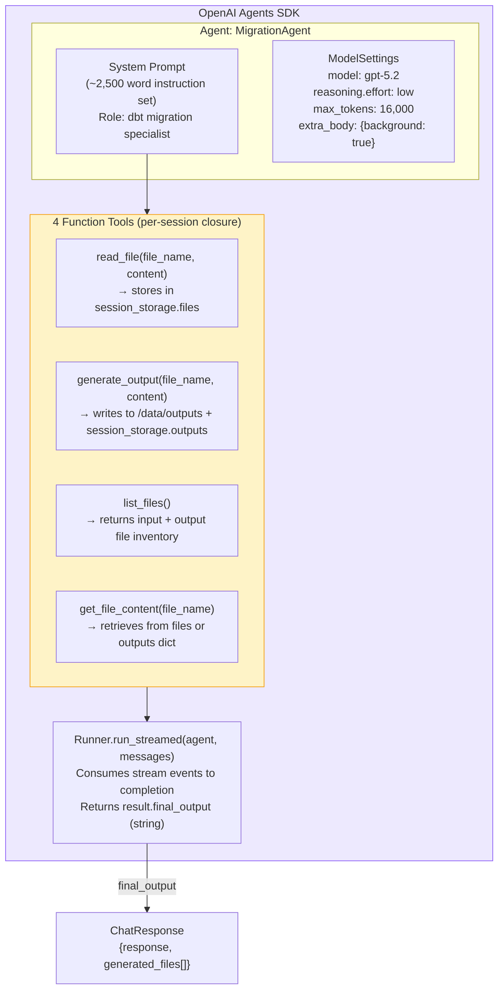

**Agent instantiation** (`get_or_create_agent()` in `migration.py`):
```python
Agent(
    name="MigrationAgent",
    instructions=INSTRUCTIONS,       # ~2,500 word system prompt
    model=settings.OPENAI_MODEL,     # "gpt-5.2" from env/config
    tools=tools,                     # 4 function_tool closures
    model_settings=ModelSettings(
        reasoning=Reasoning(effort="low"),  # lightweight reasoning for speed
        max_tokens=16000,
        extra_body={"background": True},    # background processing mode
    )
)
```

### 9.2 Session Management

Three in-memory dictionaries manage session state in the AI service:

| Dictionary | Key | Value | Purpose |
|-----------|-----|-------|---------|
| `session_storage` | session_id | `{"files": {}, "outputs": {}, "output_folder": None}` | File content for agent tools |
| `session_agents` | session_id | `Agent` instance | Cached agent with bound tools |
| `session_last_access` | session_id | `float` (timestamp) | TTL tracking |

**Eviction** (`_evict_stale_sessions()`, called on every storage access):
1. Delete sessions idle > `SESSION_TTL_SECONDS` (3600s / 1 hour)
2. If count > `SESSION_MAX_COUNT` (50), evict oldest by access time

**Rehydration**: When backend sends `request.files` dict, the AI service repopulates `session_storage["files"]` from the request payload (files originally persisted in PostgreSQL by the backend).

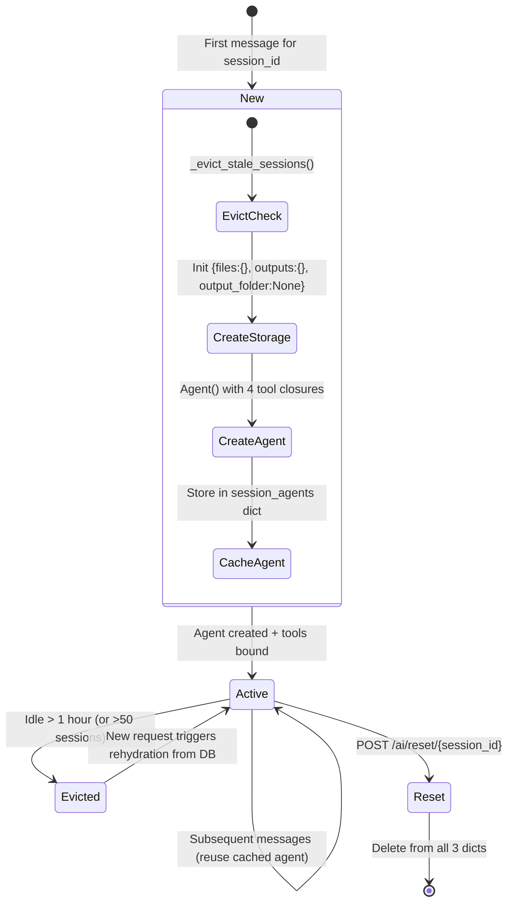

### 9.3 Tool Implementations

Each tool is a `@function_tool`-decorated closure that captures the session's storage reference:

**`read_file(file_name: str, content: str) -> str`**
- Stores `content` in `storage["files"][file_name]`
- Returns: `"File '{file_name}' loaded ({len(content)} characters)."`
- Called by agent when it processes uploaded file content from the user message

**`generate_output(file_name: str, content: str) -> str`**
- Creates output folder if needed: `/data/outputs/{session_id}/{YYYY-MM-DD_HH-MM-SS}/`
- Writes file to disk: `Path(output_folder/file_name).write_text(content)`
- Stores in `storage["outputs"][file_name]`
- Returns: `"File saved to: {saved_path}"`

**`list_files() -> str`**
- Returns formatted string: `"Input files: a.csv, b.sql\nOutput files: model.sql\nOutput folder: /path"`

**`get_file_content(file_name: str) -> str`**
- Searches `storage["files"]` first, then `storage["outputs"]`
- Returns file content or `"File '{file_name}' not found."`

### 9.4 Chat Request Processing (POST /ai/chat)

The complete flow from request to response:

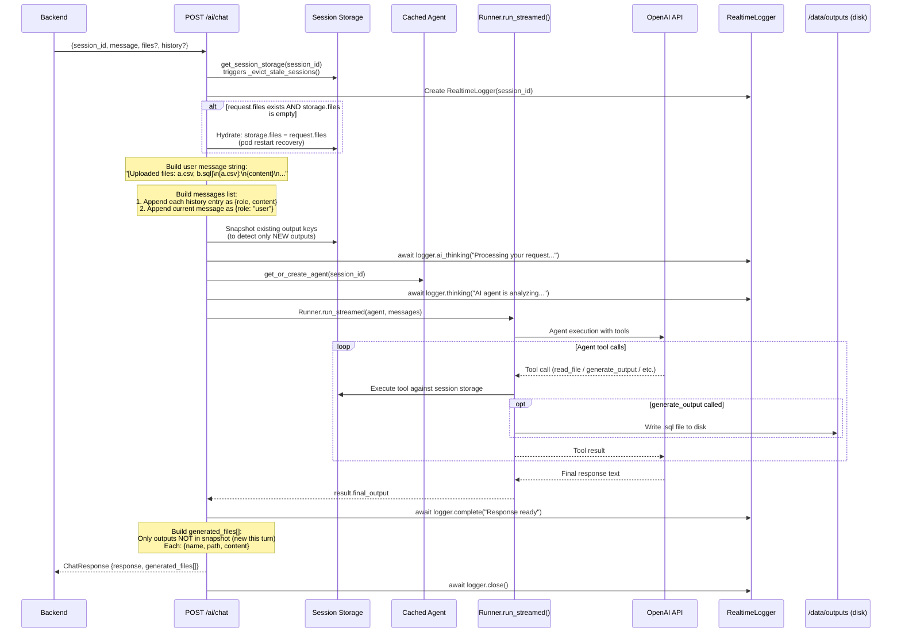

**Request payload** (`ChatRequest`):
```python
{
    "session_id": "uuid",
    "message": "Add field X to the staging model",
    "files": {"template.csv": "content...", "mapping.csv": "content..."},  # optional
    "history": [{"role": "user", "content": "..."}, {"role": "assistant", "content": "..."}]  # optional
}
```

**Response payload** (`ChatResponse`):
```python
{
    "response": "Here is the updated model with field X added...",
    "generated_files": [
        {"name": "AMS_AI_DBT_STG_ADD_INFO_updated.sql", "path": "/data/outputs/.../file.sql", "content": "SELECT..."}
    ]
}
```

### 9.5 Message Construction

The backend constructs the AI service request in `chat.ts`:

1. Fetches session with uploaded files and last 20 messages (DESC order)
2. Builds `files` dict: `{filename: content}` from all `UploadedFile` rows with non-empty content
3. Reverses messages to chronological order, maps to `[{role, content}]`
4. Sends to AI service with 600-second timeout (10 minutes)

The AI service then augments the user message with file context:
```
[Uploaded files: template.csv, mapping.csv, reference_model.sql]
[template.csv]:
{full CSV content}
[mapping.csv]:
{full CSV content}
{original user message}
```

### 9.6 System Prompt (Agent Instructions)

The agent operates under a ~2,500 word instruction set with 4 sections:

**Hard Rules** (never skip):
1. Confirm base/dependency model before writing FROM clause — never guess `{{ ref('...') }}` targets
2. Never drop a CTE between regenerations — compare against previous version
3. Never truncate or omit fields — output all 50+ if needed, no `...` abbreviations
4. Never assume or fabricate context — stop and ask clarifying questions

**Workflow** (strict order):
1. Analyze all uploaded files first using `get_file_content` tool
2. Ask before assuming — flag TBD fields, datatype conflicts, ambiguous joins, unclear transforms
3. Generate dbt model following code rules
4. Run self-validation checklist

**Code Generation Rules**:

| Rule | Detail |
|------|--------|
| Source Selection | Always use `{{ ref('...') }}`, never default to base tables without explicit instruction |
| CTEs | Every source table gets its own CTE; never drop CTEs between regenerations |
| Field Propagation | Every mapped field must appear in final SELECT |
| Null Handling | `IFNULL(field, default)` to replace nulls; `NULLIF` only to convert value TO null |
| Datatype Alignment | Match template exactly; flag Boolean-vs-VARCHAR conflicts |
| Defaults | Use template defaults; NOT NULL fields must never output NULL |
| WHERE Clauses | Include filtering macros, filter to current/non-deleted rows |
| CASE Expressions | Always include ELSE branch; handle NULLs explicitly |
| Jinja Patterns | Match `{{ config() }}`, `{{ source() }}`, `{{ ref() }}` from existing models |
| MINUS/EXCEPT | Ensure both sides produce same type and default to avoid false-positive diffs |

**Self-Validation Checklist** (11 checks before output):
1. Every mapping field present in final SELECT
2. FROM/JOIN use ref models, not raw tables
3. All referenced CTEs are defined
4. Datatypes match template
5. No `NULLIF` where `IFNULL` intended
6. NOT NULL fields have defaults
7. WHERE clauses present with correct source macros
8. Row count sanity (filters implemented)
9. CASE expressions have ELSE and handle NULLs
10. No CTEs dropped from prior generation
11. Defaults consistent for MINUS/EXCEPT comparisons

### 9.7 Real-Time Logging

The `RealtimeLogger` class sends HTTP POST requests to the backend during agent execution:

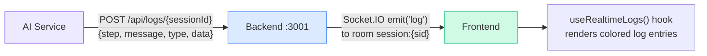

| Log Method | Step | Type | When Called |
|-----------|------|------|------------|
| `logger.ai_thinking(msg)` | `ai_processing` | `progress` | Start of request processing |
| `logger.thinking(msg)` | `thinking` | `thinking` | Agent begins analysis |
| `logger.complete(msg)` | `complete` | `success` | Response ready |
| `logger.error(msg)` | `error` | `error` | Exception during processing |

Logger uses `httpx.AsyncClient(timeout=5.0)` and silently catches all exceptions — logging failures never break the main agent flow.

### 9.8 Speech-to-Text

The STT endpoint (`POST /ai/stt`) accepts audio uploads and returns transcribed text:

1. Validates content type: `audio/*` or `application/octet-stream` (MediaRecorder default)
2. Maps content type to extension: webm, ogg, wav, mp4, mp3 (defaults to webm)
3. Calls `client.audio.transcriptions.create(model="gpt-4o-transcribe", file=(filename, audio_bytes))`
4. Returns `{"text": transcript.text}`

### 9.9 Backend-AI Service Integration

The backend (`aiService.ts`) wraps the AI service call with:
- **Timeout**: 600,000ms (10 minutes) for long SQL generation tasks
- **Content-Type**: `application/json`
- **Error handling**: Extracts error detail from AI service response, re-throws with context

After receiving the AI response, the backend:
1. Saves assistant message to `Message` table
2. Upserts each generated file to `GeneratedOutput` table (compound unique on `sessionId_filename`)
3. On first message, auto-names the session (first 50 chars of user message)

### 9.10 Bug Fixes in Agent Code

The codebase contains documented fixes for production issues:

| Bug | Problem | Fix |
|-----|---------|-----|
| Bug 2 | Message truncation from string concatenation | Changed to structured message list with `{role, content}` objects |
| Bug 3 | New agent created per message (lost context) | Cache agents in `session_agents` dict, reuse across messages |
| Bug 4 | All outputs returned on every response (duplicates) | Snapshot output keys before processing, only return new outputs |
| Bug 7 | Empty session after pod restart (lost files) | Hydrate `session_storage` from `request.files` when storage is empty |

---

## 10. API Surface

### 10.1 Backend REST API (Port 3001)

| Method | Endpoint | Description |
|--------|----------|-------------|
| `POST` | `/api/sessions` | Create new session |
| `GET` | `/api/sessions` | List sessions (paginated, cursor-based) |
| `GET` | `/api/sessions/:id` | Get session with messages, files, outputs |
| `PATCH` | `/api/sessions/:id` | Rename session |
| `DELETE` | `/api/sessions/:id` | Delete session (cascade) |
| `GET` | `/api/sessions/:id/outputs` | List generated outputs |
| `POST` | `/api/chat/:sessionId/messages` | Send message (proxied to AI) |
| `GET` | `/api/chat/:sessionId/messages` | Get message history |
| `POST` | `/api/files/:sessionId/upload` | Upload files (max 10, multipart) |
| `GET` | `/api/files/:sessionId` | List uploaded files |
| `DELETE` | `/api/files/:fileId` | Delete file |
| `GET` | `/api/files/uploaded/:fileId/content` | File content as JSON |
| `GET` | `/api/files/uploaded/:fileId/download` | Download uploaded file |
| `GET` | `/api/files/output/:outputId/download` | Download generated SQL |
| `POST` | `/api/stt` | Transcribe audio (proxied to AI) |
| `GET` | `/api/health` | Health check |
| `POST` | `/api/logs/:sessionId` | Receive logs from AI service |

### 10.2 AI Service API (Port 8084)

| Method | Endpoint | Description |
|--------|----------|-------------|
| `POST` | `/ai/chat` | Process message with agent |
| `GET` | `/ai/health` | Health check (model info) |
| `POST` | `/ai/reset/:sessionId` | Clear in-memory state |
| `GET` | `/ai/status/:sessionId` | Session file inventory |
| `POST` | `/ai/stt` | Transcribe audio (Whisper) |

### 10.3 WebSocket Events (Socket.IO)

| Event | Direction | Payload |
|-------|-----------|---------|
| `join-session` | Client to Server | `{ sessionId }` |
| `leave-session` | Client to Server | `{ sessionId }` |
| `log` | Server to Client | `{ timestamp, step, message, type, data }` |

---

## 11. Monitoring & Observability

| Capability | Status | Details |
|-----------|--------|---------|
| Health checks | **Yes** | `/api/health` and `/ai/health` |
| K8s probes | **Yes** | Liveness and readiness configured |
| Application logs | **Basic** | Console logs with prefixes (`[REQ]`, `[CHAT]`, `[UPLOAD]`) |
| Real-time logs | **Yes** | Agent progress streamed via Socket.IO |
| Metrics | **None** | No Prometheus/Grafana |
| Distributed tracing | **None** | No request correlation |
| Error tracking | **None** | No Sentry |
| Alerting | **None** | No PagerDuty/OpsGenie |

---

## 12. Known Limitations

| Limitation | Impact | Mitigation |
|-----------|--------|------------|
| Single replica per service | No HA, downtime on restart | Scale replicas |
| In-memory agent cache | Lost on pod restart | Rehydrated from DB |
| No authentication | Public access | Add auth before rollout |
| 50 concurrent session limit | AI service cap | Scale horizontally or add Redis |
| 10-minute request timeout | Long generations may fail | Stream partial results |
| Single-node K3s | SPOF | Move to managed K8s |
| Single PostgreSQL instance | SPOF for data | Move to managed DB |
| No backups configured | Data loss risk | Set up pg_dump or WAL |

---

## 13. Scalable Architecture Plan

### 13.1 Target Architecture

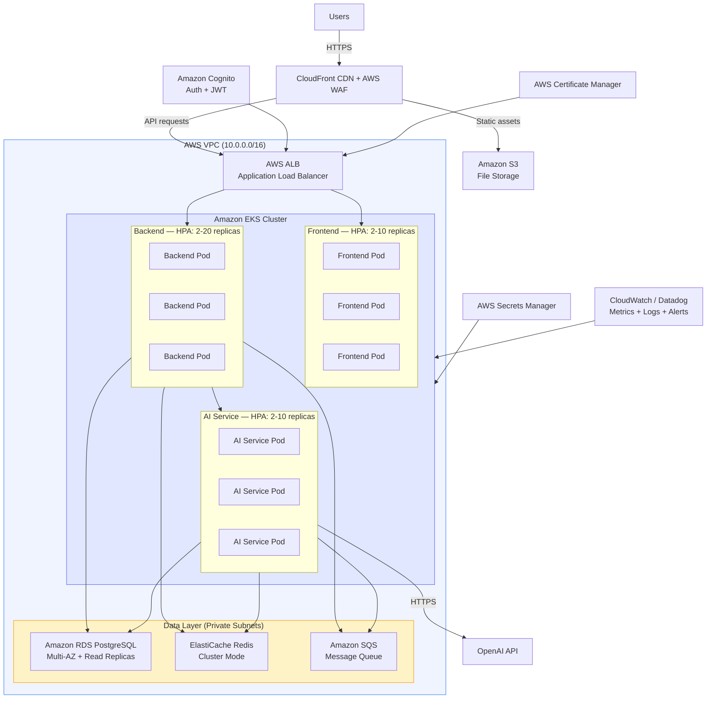

### 13.2 Component Upgrade Map

| Current | Scalable | Why |
|---------|----------|-----|
| K3s (single node) | **Amazon EKS** (multi-AZ) | HA, auto-scaling, managed control plane |
| Traefik | **AWS ALB** | Layer 7 routing, WAF, health checks |
| External PostgreSQL | **Amazon RDS** (Multi-AZ, read replicas) | Automated backups, failover |
| In-memory cache | **ElastiCache Redis** | Shared state across pods |
| Files in DB TEXT | **Amazon S3** + CloudFront | Unlimited storage, fast downloads |
| `.env` files | **AWS Secrets Manager** | Rotation, IAM access, audit |
| No auth | **Amazon Cognito** | JWT, SSO, user management |
| No CDN | **CloudFront** | Edge caching, DDoS protection |
| No WAF | **AWS WAF** | Injection/XSS protection, rate limiting |
| Console logs | **CloudWatch / Datadog** | Centralized observability |
| No queue | **Amazon SQS** | Decouple AI processing, backpressure |
| Single replicas | **HPA** | Auto-scale on CPU/memory/queue depth |
| No backups | **RDS auto-backups + S3 versioning** | Point-in-time recovery |

### 13.3 Security Layers (Scalable)

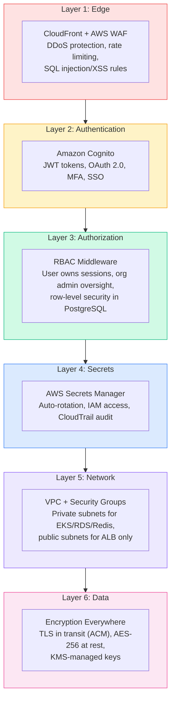

### 13.4 Observability Stack (Scalable)

| Category | Metrics |
|----------|---------|
| **Metrics** | Request latency (p50/p95/p99), error rates, pod CPU/memory, DB connections, Redis hit/miss, OpenAI latency/tokens, SQS depth, active WebSockets |
| **Logs** | Structured JSON, request ID correlation across services, 30-day retention, S3 archive |
| **Traces** | End-to-end request tracing (AWS X-Ray / Datadog APM), service map, bottleneck ID |
| **Alerts** | Error rate >5% (PagerDuty), p99 >30s (Slack), SQS >100 (auto-scale), DB >80% connections (warning) |

### 13.5 Cost Estimate (Scalable)

| Service | Configuration | Monthly Cost |
|---------|--------------|-------------|
| EKS | Control plane + 3x t3.large | ~$250 |
| RDS PostgreSQL | db.r6g.large, Multi-AZ | ~$350 |
| ElastiCache Redis | cache.r6g.large, 2 nodes | ~$300 |
| ALB | 1 ALB + data processing | ~$50 |
| CloudFront | 100GB transfer | ~$20 |
| S3 | 100GB storage | ~$5 |
| Secrets Manager + SQS + Cognito | Various | ~$10 |
| CloudWatch | Logs + metrics | ~$50 |
| **Infrastructure Total** | | **~$1,035/month** |
| **OpenAI API** | Variable (token usage) | **$200-2,000/month** |

---

## 14. System Design Flowcharts — Scalable

### 14.1 Scalable Request Flow

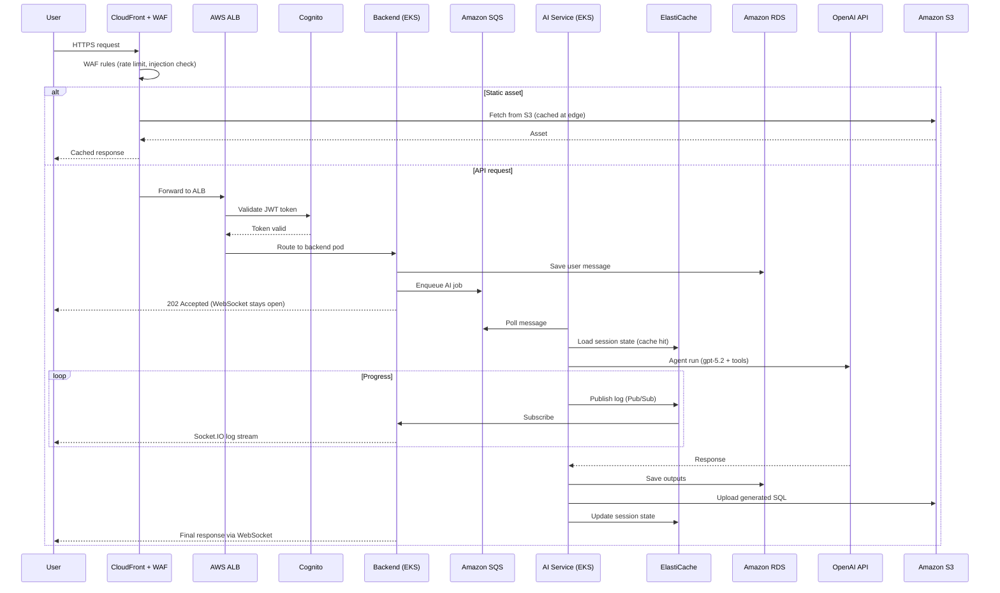

### 14.2 Multi-AZ Deployment

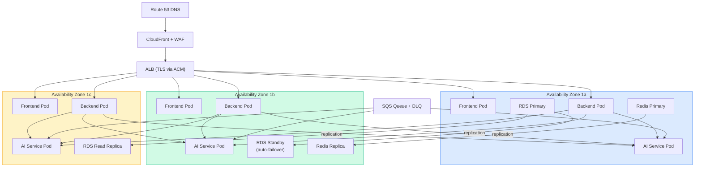

### 14.3 Auto-Scaling Strategy

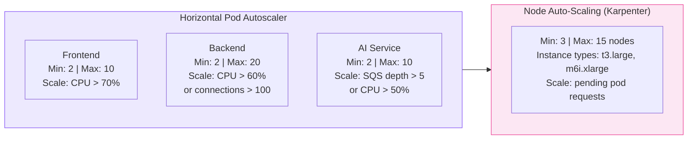

### 14.4 CI/CD Pipeline

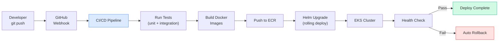

---

## 15. Migration Roadmap: Current to Scalable

### Phase 1: Foundation (Weeks 1-2)
- [ ] AWS account setup with IAM roles
- [ ] VPC with public/private subnets across 3 AZs
- [ ] Provision RDS PostgreSQL (Multi-AZ), migrate data
- [ ] Provision ElastiCache Redis
- [ ] Set up ECR for Docker images

### Phase 2: Compute and Networking (Weeks 3-4)
- [ ] Create EKS cluster with managed node groups
- [ ] ALB Ingress Controller setup
- [ ] ACM certificates for TLS
- [ ] Deploy all services to EKS with HPA
- [ ] Route 53 DNS records

### Phase 3: Security and Auth (Weeks 5-6)
- [ ] Amazon Cognito user pool
- [ ] JWT authentication middleware
- [ ] RBAC implementation
- [ ] Migrate secrets to AWS Secrets Manager
- [ ] Enable RDS encryption, configure WAF

### Phase 4: Storage and Performance (Week 7)
- [ ] Migrate files from DB TEXT to S3
- [ ] CloudFront CDN for frontend + S3
- [ ] Replace in-memory cache with Redis
- [ ] SQS queue for AI job processing
- [ ] Redis Pub/Sub for real-time logs

### Phase 5: Observability and CI/CD (Week 8)
- [ ] CloudWatch / Datadog metrics, logs, traces
- [ ] Alerting (PagerDuty/Slack)
- [ ] GitHub Actions CI/CD pipeline
- [ ] Helm charts for deployments
- [ ] Automated DB backups + S3 lifecycle

### Phase 6: Testing and Launch (Weeks 9-10)
- [ ] Load testing (k6 / Locust)
- [ ] Chaos engineering (pod kills, DB failover)
- [ ] Security audit (penetration testing)
- [ ] Gradual traffic migration (blue-green / canary)
- [ ] Decommission K3s single-node

### Roadmap Timeline

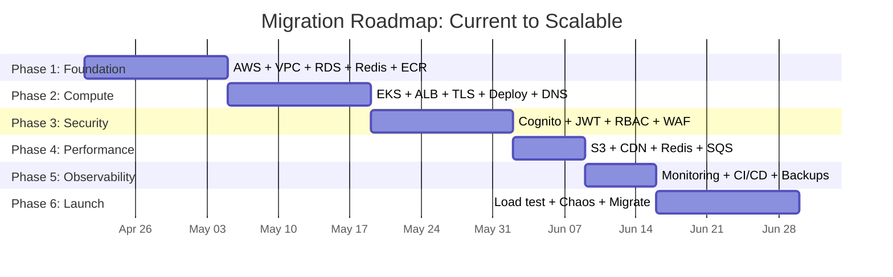

---

*Document generated April 14, 2026.*
