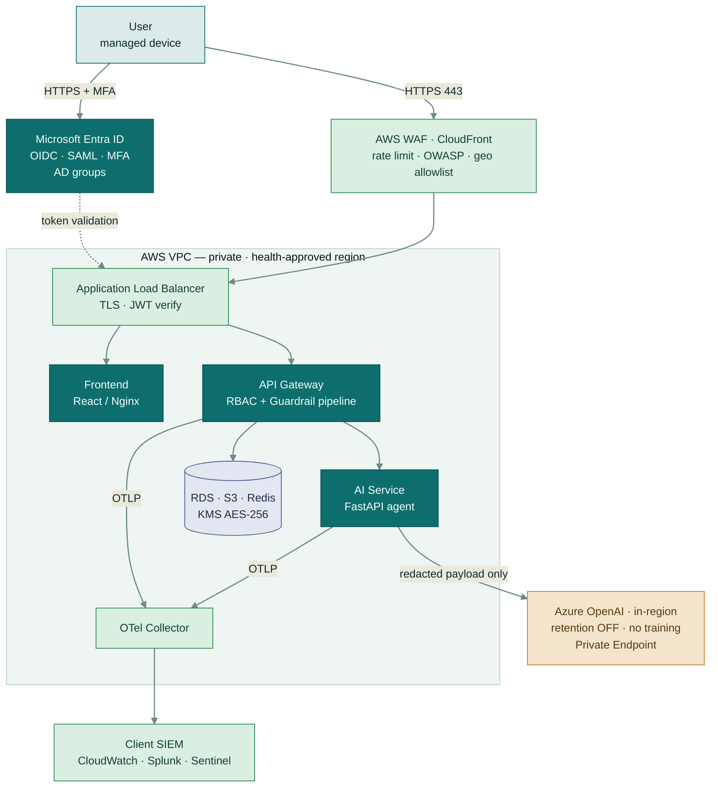
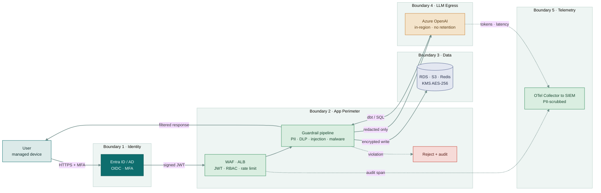
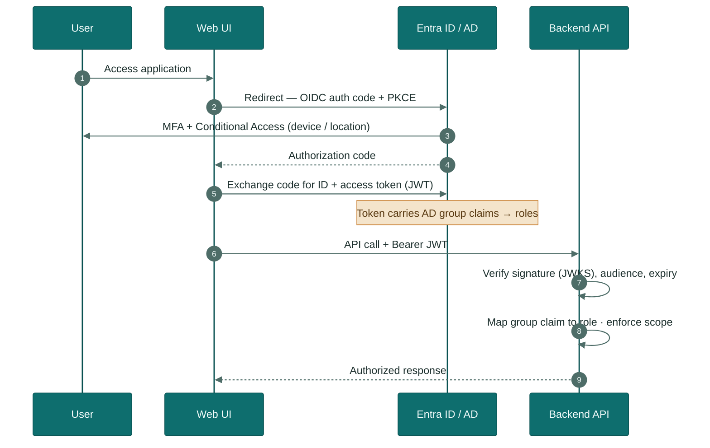
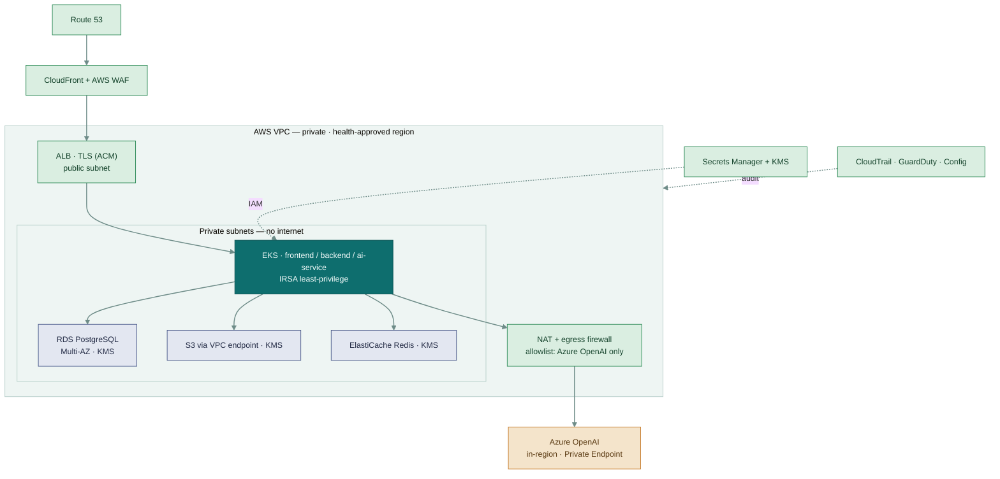
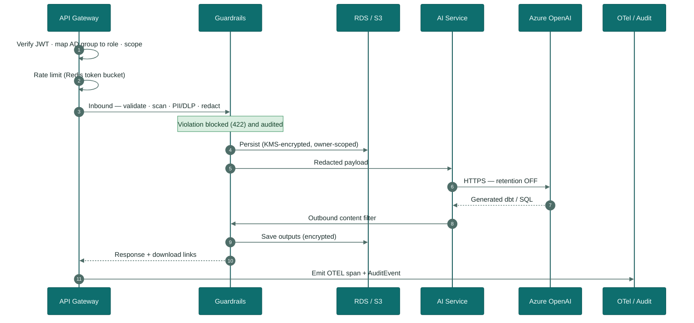

# Circini Migration Agent — Secure Architecture (New Zealand Health)

> **Version**: 2.0 | **Date**: July 20, 2026
> **Classification**: SENSITIVE — MEDICAL IN CONFIDENCE
> **Audience**: Client security & architecture review (New Zealand health sector)

This document describes the **target secure architecture** for deploying the Circini Migration
Agent inside a New Zealand health client's environment. It is designed to be compliant with NZ
health information rules (Privacy Act 2020, Health Information Privacy Code 2020, HISO 10029:2022),
cross-mapped to HIPAA-equivalent safeguards. See [§14 Sources & Compliance References](#14-sources--compliance-references).

**Diagram key:** teal = compute/app · light teal = client zone · green = security control ·
blue-grey = encrypted data store · amber = external egress · red = blocked/denied.

---

## Table of Contents

1. [Executive Summary](#1-executive-summary)
2. [Compliance Basis & Data Classification](#2-compliance-basis--data-classification)
3. [High-Level Design (HLD)](#3-high-level-design-hld)
4. [Technology Stack](#4-technology-stack)
5. [Data Formats Ingested & Processed](#5-data-formats-ingested--processed)
6. [Data Flow Diagram (DFD) & Trust Boundaries](#6-data-flow-diagram-dfd--trust-boundaries)
7. [Authentication & Authorization (Entra ID / AD)](#7-authentication--authorization-entra-id--ad)
8. [Data Protection & Security Controls](#8-data-protection--security-controls)
9. [AI Governance & Guardrails](#9-ai-governance--guardrails)
10. [Observability & Telemetry (OpenTelemetry)](#10-observability--telemetry-opentelemetry)
11. [Deployment View — AWS Infrastructure Security](#11-deployment-view--aws-infrastructure-security)
12. [Low-Level Design (LLD)](#12-low-level-design-lld)
13. [Compliance Control Matrix — How Each Concern Is Ensured](#13-compliance-control-matrix--how-each-concern-is-ensured)
14. [Sources & Compliance References](#14-sources--compliance-references)

---

## 1. Executive Summary

The **Circini Migration Agent** is an AI assistant that generates Snowflake-compatible dbt/SQL
models for data migrations. Technical users upload mapping documents, templates and reference SQL
through a chat interface; an LLM agent produces validated dbt models.

Deployed in a health environment, the tool sits behind the client's identity provider (Microsoft
**Entra ID / Active Directory**), runs on hardened **AWS** infrastructure, and reaches the LLM only
via **Azure OpenAI** in-region with retention disabled. Every request passes through a **guardrail
pipeline** (PII/DLP, input sanitisation, prompt-injection and malware scanning, redaction) before
any content leaves a trust boundary, and every user action is captured as **OpenTelemetry** audit
telemetry for AI governance.

| Tier | Technology | Role |
|------|-----------|------|
| Frontend | React 18 + Vite + TypeScript | Chat UI, file upload, live logs |
| Backend | Node.js + Express + Prisma | REST API, RBAC, guardrail enforcement |
| AI Service | Python FastAPI + LangGraph | Agent orchestration (Bedrock GPT-OSS; OpenAI/Azure selectable) |
| Identity | Microsoft Entra ID (OIDC/SAML) | SSO, AD-group → role mapping, MFA |
| Data | Amazon RDS PostgreSQL + S3 (KMS) | Encrypted sessions, files, outputs |

---

## 2. Compliance Basis & Data Classification

### 2.1 Regulatory basis

| Framework | Applied to |
|-----------|-----------|
| **Privacy Act 2020** (13 IPPs) | Lawful collection, use, storage, access of personal information |
| **Health Information Privacy Code 2020** (13 rules) | Health-specific handling, retention, disclosure controls |
| **HISO 10029:2022 Health Information Security Framework** | Technical & organisational security controls baseline |
| **HISO 10064:2017 Health Information Governance** | Governance, roles, accountability |
| **NZISM / PSR** | Government-grade infrastructure & protective security |
| **ISO/IEC 27001:2022** | ISMS control set |
| **NIST AI RMF + OWASP LLM Top 10** | AI-specific risk & guardrails |
| **HIPAA Security Rule** (cross-map) | Equivalent administrative/physical/technical safeguards |

### 2.2 Two operating modes (config-gated)

The tool defaults to a **metadata-only** posture. Handling of real health data is a separate,
explicitly-enabled mode with stricter controls.

| | **Mode A — Metadata-only (default)** | **Mode B — PHI-permitted (config-gated)** |
|--|--------------------------------------|-------------------------------------------|
| Data in scope | Schema, mappings, DDL, dbt/SQL, config, tech docs | Real health-identifiable data (e.g. NHI, patient fields) |
| Health PII | **Blocked** by guardrails before egress | De-identified/redacted before model submission |
| LLM egress | Redacted metadata only | In-region Azure OpenAI only, redaction enforced |
| Audit | Standard action audit | Full access audit of every health-information touch |
| Enabled by | Default | `PHI_MODE=true` + data-custodian sign-off |

`NHI` = National Health Index number — treated as a first-class identifier for detection/redaction.

---

## 3. High-Level Design (HLD)

Identity is delegated to the client's Entra ID/AD; all compute runs in a private AWS VPC; the only
outbound path is a redaction-gated call to in-region Azure OpenAI; all telemetry flows to the SIEM.

**Key properties:** identity delegated to Entra ID/AD; compute in a private AWS VPC; a single
redaction-gated egress to in-region Azure OpenAI; KMS encryption at rest; telemetry to the SIEM.

---

## 4. Technology Stack

| Layer | Components |
|-------|-----------|
| Frontend | React 18, Vite, TypeScript, TailwindCSS, Socket.IO client |
| Backend | Node.js 20, Express, Prisma, Socket.IO, Multer, `zod` validation |
| AI Service | Python 3.12, FastAPI, LangGraph + langchain-aws (Bedrock Converse), DynamoDB checkpoints, Pydantic |
| Guardrails | Presidio (PII/DLP), ClamAV (malware), prompt-injection classifier, allow/deny lists |
| Identity | Microsoft Entra ID (OIDC/SAML), MSAL, JWT (RS256) |
| Data | Amazon RDS PostgreSQL 15, Amazon S3, ElastiCache Redis — all AWS KMS-encrypted |
| Infra | Amazon EKS, ALB, AWS WAF, CloudFront, Secrets Manager, KMS, VPC private subnets |
| Observability | OpenTelemetry SDK + Collector → CloudWatch / client SIEM |
| LLM | Azure OpenAI (in-region, retention disabled, Private Endpoint) |

---

## 5. Data Formats Ingested & Processed

All inputs are parsed to normalized UTF-8 text server-side, validated, and scanned by guardrails
before storage or model submission.

| Format | Extensions | Parsing / Handling |
|--------|-----------|--------------------|
| Excel | `.xlsx`, `.xls` | SheetJS → CSV text; macro/formula stripped; malware-scanned |
| Delimited | `.csv`, `.tsv` | Parsed to typed rows; header + type inference |
| Structured relational | DDL, schema exports | Treated as metadata; no live DB connection required |
| JSON documents | `.json` | Parsed, schema-validated, pretty-printed |
| Configuration files | `.yaml`, `.yml`, `.xml`, `.env`-style | Secret patterns detected & redacted on ingest |
| Technical documentation | `.md`, `.txt`, `.sql`, `.py`, `.js`, `.ts`, `.log` | UTF-8 text; size- and content-validated |
| Metadata repositories | catalog/mapping exports | Ingested as reference metadata for model generation |

**Limits:** ≤ 10 files/request, ≤ 10 MB/file, extension **and** MIME sniffing enforced, magic-byte
verification, malware scan (ClamAV) before persistence.

---

## 6. Data Flow Diagram (DFD) & Trust Boundaries

Five trust boundaries from identity to telemetry. Data is redacted before the LLM egress and
encrypted before any store; a policy violation is blocked and audited rather than forwarded.

### 6.1 Trust boundaries, ingress & egress

| Boundary | Ingress point | Egress point | Controls at boundary |
|----------|--------------|--------------|----------------------|
| **B1 — Identity** | Entra ID login | Signed JWT to UI | MFA, Conditional Access, device compliance |
| **B2 — App perimeter** | WAF → ALB → API GW | Response to UI | WAF/OWASP, JWT verify, RBAC, rate limit, guardrails |
| **B3 — Data** | API GW → RDS/S3 | Query results | KMS encryption at rest, TLS in transit, row-level scoping |
| **B4 — LLM egress** | — | AI Service → Azure OpenAI | Redaction enforced, allowlisted endpoint, no retention |
| **B5 — Telemetry** | Services → OTel Collector | Collector → SIEM | Scrubbed logs (no payload PII), mTLS to SIEM |

---

## 7. Authentication & Authorization (Entra ID / AD)

Authentication is delegated to the client's **Microsoft Entra ID / Active Directory**. The
application holds no passwords. Authorization is **role-based**, with roles derived from AD security
group membership — the standard enterprise pattern.

### 7.1 AD group → application role mapping

| AD security group | App role | Permissions |
|-------------------|----------|-------------|
| `Migration-Admins` | `admin` | All sessions, user/audit oversight, config, PHI-mode toggle |
| `Migration-Users` | `analyst` | Own sessions only, upload/generate, download own outputs |
| `Migration-Auditors` | `auditor` | Read-only audit logs & telemetry, no data access |

### 7.2 Authentication flow (OIDC Authorization Code + PKCE)

**Controls:** RS256 JWT with JWKS rotation; short-lived access tokens + refresh; MFA and
Conditional Access enforced at the IdP; least-privilege scopes; every authz decision audited.

---

## 8. Data Protection & Security Controls

### 8.1 Controls by layer

| Layer | Control |
|-------|---------|
| **Edge** | CloudFront + AWS WAF (OWASP rule set, rate limiting, IP/geo allowlist, DDoS) |
| **Transport** | TLS 1.2+ everywhere (ACM); HSTS; mTLS service-to-service in VPC |
| **AuthN/AuthZ** | Entra ID SSO + MFA; JWT verification; AD-group RBAC; row-level session scoping |
| **API access** | All endpoints require valid JWT; per-role scopes; per-user + per-IP rate limits; CORS locked to client origin |
| **Application** | `zod` input validation; output encoding (XSS); Prisma parameterised queries (SQLi) |
| **Guardrails** | PII/DLP, prompt-injection, malware, redaction (see §9) |
| **Data at rest** | RDS + S3 + Redis encrypted with **AWS KMS (AES-256)**; TDE; encrypted backups/snapshots |
| **Secrets** | AWS Secrets Manager + KMS; auto-rotation; IAM least-privilege; no secrets in env/images |
| **Network** | Private subnets for compute/data; no public DB; egress allowlist (Azure OpenAI only); VPC flow logs |
| **Data at rest — LLM** | Azure OpenAI retention **disabled**, no training on data, in-region processing, Private Endpoint |

### 8.2 Data at rest summary

| Store | Data | Encryption | Retention |
|-------|------|-----------|-----------|
| RDS PostgreSQL | Sessions, messages, file text, outputs | KMS AES-256 + TDE | Config-led (§9.3) |
| Amazon S3 | Uploaded files, generated outputs | KMS AES-256, versioned | Config-led + lifecycle |
| ElastiCache Redis | Session/rate/guardrail state | In-transit + at-rest TLS/KMS | TTL (ephemeral) |
| OTel/SIEM | Audit telemetry (PII-scrubbed) | Per client SIEM policy | Config-led (audit) |

---

## 9. AI Governance & Guardrails

Guardrails run **inbound** (before model submission) and **outbound** (before returning results),
enforced in the API gateway/AI service — never optional, never client-side only.

### 9.1 Guardrail pipeline

```mermaid
%%{init:{'theme':'base','themeVariables':{'fontFamily':'Helvetica,Arial,sans-serif','fontSize':'13px','lineColor':'#6E8C88'}}}%%
flowchart LR
  IN["User input<br/>+ files"]:::zone
  V1["Input validation<br/>and sanitisation"]:::ctrl
  V2["File scan<br/>MIME · magic-byte · ClamAV"]:::ctrl
  V3["PII / DLP detection<br/>NHI · IRD · DOB · name"]:::ctrl
  V4["Prompt-injection<br/>detection"]:::ctrl
  V5["Restricted-pattern<br/>+ content filter"]:::ctrl
  V6["Redaction<br/>before model submission"]:::app
  M["Azure OpenAI"]:::ext
  O1["Output content filter<br/>PII / secret leak check"]:::ctrl
  OUT["Response to user"]:::zone
  BLK["Reject + audit"]:::block
  IN --> V1 --> V2 --> V3 --> V4 --> V5 --> V6 --> M --> O1 --> OUT
  V2 -.-> BLK
  V3 -.-> BLK
  V4 -.-> BLK

  classDef zone fill:#DCEAE9,stroke:#0E6E6E,color:#0F2B2A;
  classDef app fill:#0E6E6E,stroke:#0A5252,color:#F2FBFA;
  classDef ctrl fill:#DAEEE1,stroke:#2E8B57,color:#14432B;
  classDef ext fill:#F4E4CB,stroke:#C77D2E,color:#5A3A12;
  classDef block fill:#F6DBD8,stroke:#C0392B,color:#5A1A14;
  linkStyle default stroke:#6E8C88,stroke-width:1.5px;
```

### 9.2 Data-protection guardrails & AI-safety controls

| Control | Implementation |
|---------|----------------|
| **PII detection** | Presidio + NZ recognisers (NHI, IRD, DOB, name, address, phone, email) on all input/output |
| **DLP checks** | Policy engine blocks/redacts classified data; Mode A blocks health PII outright |
| **Input validation & sanitisation** | `zod` schemas, length/encoding checks, HTML/script stripping |
| **Prompt-injection detection** | Classifier + heuristic rules; system-prompt isolation; tool-call allowlist |
| **Malware / content scanning** | ClamAV on every uploaded file before persistence |
| **Restricted prompt patterns** | Deny-list of unsafe/non-intended requests; scope-limited system prompt |
| **Content filtering** | Azure OpenAI content filters + local filters on input and output |
| **Sensitive-data redaction** | Redaction applied **before** any content leaves the app to the model |

### 9.3 Governance: action tracking & retention

Every user action — **query, response, file upload, download, generation, block decision** — is
recorded as structured audit telemetry (who, what, when, decision, data class; **payload bodies
excluded/scrubbed**).

| Setting | Default | Notes |
|---------|---------|-------|
| `AUDIT_RETENTION_DAYS` | `90` | Config-led; can be lowered (technical-user tool) or raised for audit needs |
| `CHAT_RETENTION_DAYS` | `30` | Session/message retention; auto-purge job |
| `FILE_RETENTION_DAYS` | `30` | Uploaded files + outputs; S3 lifecycle |
| `PHI_MODE` | `false` | Enables health-data handling with stricter audit |

Rights to access/correct/erase per Privacy Act 2020 (IPP 6/7) and HIPC 2020 are supported via
admin/auditor tooling.

---

## 10. Observability & Telemetry (OpenTelemetry)

All services emit **standardized OpenTelemetry (OTEL)** signals — traces, metrics, logs — over OTLP
to a Collector, which exports to the **client's monitoring platform** (CloudWatch, Splunk, Azure
Sentinel, Datadog). This ensures interoperability and governance of tool usage.

| Signal | Emitted | Purpose |
|--------|---------|---------|
| **Traces** | End-to-end span per request across UI→GW→AI→LLM | Latency, bottlenecks, request correlation |
| **Metrics** | Requests, error rate, LLM tokens/latency/cost, guardrail blocks, active users | Usage governance, capacity, cost |
| **Logs** | Structured JSON, correlation IDs, **PII-scrubbed** | Audit, troubleshooting |
| **AI-governance events** | Query/response/upload/download/block with actor + data class | Tool-usage oversight, compliance reporting |

Semantic conventions (`gen_ai.*`) capture model, token counts and safety decisions so the client
can monitor AI usage in their existing dashboards without bespoke integration.

---

## 11. Deployment View — AWS Infrastructure Security

Compute and data sit in private subnets with no public IPs. Egress is firewalled to the Azure
OpenAI endpoint alone; secrets, identity, and threat detection are managed AWS-native.

| Concern | Control |
|---------|---------|
| Compute isolation | EKS in private subnets; no public IPs; security groups least-privilege |
| Identity to AWS | IAM Roles for Service Accounts (IRSA); no static keys in pods |
| Secured API access | ALB + JWT auth + WAF; private service-to-service only |
| Data at rest | KMS on RDS, S3, Redis, EBS, snapshots |
| Egress control | NAT + firewall allowlisting Azure OpenAI endpoint only; VPC flow logs |
| Threat detection | GuardDuty, AWS Config, CloudTrail → SIEM |
| Residency | Health-approved AWS region; data does not leave region except redacted LLM egress |

---

## 12. Low-Level Design (LLD)

### 12.1 Request lifecycle (per API call)

Every API call runs the same ordered pipeline — authenticate, authorise, rate-limit, guardrail,
persist encrypted, call the model on a redacted payload, filter output, then audit.

### 12.2 Data model (encrypted at rest)

| Table | Key fields | Scope / security |
|-------|-----------|------------------|
| `User` *(new)* | id, entra_oid, roles | Mirror of Entra identity; no password stored |
| `Session` | id, ownerUserId, name, ts | **Row-level scoped to owner**; admin override audited |
| `Message` | id, sessionId, role, content | Cascade-delete; retention job; encrypted |
| `UploadedFile` | id, sessionId, filename, content, dataClass | Guardrail-verified; encrypted; S3-backed |
| `GeneratedOutput` | id, sessionId, filename, content | Output-filtered; encrypted |
| `AuditEvent` *(new)* | id, userId, action, decision, dataClass, ts | Append-only; PII-scrubbed; retention config-led |

### 12.3 Request handling steps

1. **AuthN/AuthZ** — verify JWT (JWKS), map AD group → role, enforce scope + session ownership.
2. **Rate limit** — per-user + per-IP token bucket (Redis).
3. **Guardrails inbound** — validate, scan files, PII/DLP, prompt-injection, redact.
4. **Persist** — encrypted write, row-level scoped to owner.
5. **LLM** — redacted payload → in-region Azure OpenAI (retention off).
6. **Guardrails outbound** — content filter on response/outputs.
7. **Audit + telemetry** — emit OTEL span + `AuditEvent`.

---

## 13. Compliance Control Matrix — How Each Concern Is Ensured

| Client concern | How the app ensures it | Reference |
|----------------|------------------------|-----------|
| AD-group access control | Entra ID SSO; AD group → RBAC role mapping | §7 |
| Secure data flow between components | DFD with trust boundaries, TLS/mTLS, redaction gates | §6 |
| Data secured at rest | KMS AES-256 on RDS/S3/Redis; TDE; encrypted backups | §8.2 |
| User authentication flow | OIDC Auth Code + PKCE, MFA, Conditional Access | §7.2 |
| Request/response path (all actors) | End-to-end lifecycle GW→GR→AI→LLM→Data→Observability | §12.1 |
| Data ingress/egress points | Enumerated per boundary; single controlled LLM egress | §6.1, §11 |
| Trust boundaries | Five boundaries B1–B5 with per-boundary controls | §6 |
| Security controls per layer | Layered control table | §8.1 |
| Data formats ingested | Format table + validation/scan pipeline | §5 |
| Observability for governance (OTEL) | OTLP traces/metrics/logs → client SIEM; `gen_ai.*` | §10 |
| Track user queries/responses | `AuditEvent` per action; OTEL AI-governance events | §9.3, §10 |
| Retention period (config-led, low) | `*_RETENTION_DAYS` env config; auto-purge | §9.3 |
| Guardrails vs. unintended use / PII to LLM | Inbound/outbound guardrail pipeline; DLP block in Mode A | §9 |
| PII detection | Presidio + NZ NHI/IRD recognisers | §9.2 |
| DLP checks | Policy engine block/redact by data class | §9.2 |
| Input validation & sanitisation | `zod` schemas, encoding checks | §9.2 |
| Prompt-injection detection | Classifier + heuristics + tool allowlist | §9.2 |
| Malware/content scanning of uploads | ClamAV + MIME/magic-byte on ingest | §5, §9.2 |
| Restricted prompt patterns | Deny-list + scoped system prompt | §9.2 |
| Content filtering | Azure OpenAI + local filters, input & output | §9.2 |
| Redaction before model submission | Enforced pre-egress redaction step | §9.1 |
| AWS deployment w/ infra security | Private VPC, EKS/IRSA, KMS, WAF, GuardDuty | §11 |
| AuthN/AuthZ, secured API, data security | JWT + RBAC + WAF; encrypted stores; egress allowlist | §7, §8, §11 |

---

## 14. Sources & Compliance References

New Zealand health and privacy:
- **Privacy Act 2020** — legislation.govt.nz — https://www.legislation.govt.nz/act/public/2020/0031/latest/LMS23223.html
- **Information Privacy Principles (IPPs)** — Office of the Privacy Commissioner — https://www.privacy.org.nz/privacy-act-2020/privacy-principles/
- **Health Information Privacy Code 2020** — Office of the Privacy Commissioner — https://www.privacy.org.nz/privacy-act-2020/codes-of-practice/hipc2020/
- **HISO 10029:2022 Health Information Security Framework** — Te Whatu Ora / Ministry of Health — https://www.tewhatuora.govt.nz/publications/health-information-security-framework
- **HISO 10064:2017 Health Information Governance Guidelines** — Ministry of Health — https://www.health.govt.nz/publication/hiso-100642017-health-information-governance-guidelines
- **National Health Index (NHI)** — Te Whatu Ora — https://www.tewhatuora.govt.nz/our-health-system/digital-health/national-health-index
- **New Zealand Information Security Manual (NZISM)** — GCSB — https://www.nzism.gcsb.govt.nz/
- **Protective Security Requirements (PSR)** — https://www.protectivesecurity.govt.nz/

Security & AI standards:
- **ISO/IEC 27001:2022** — https://www.iso.org/standard/27001
- **NIST AI Risk Management Framework (AI RMF 1.0)** — https://www.nist.gov/itl/ai-risk-management-framework
- **OWASP Top 10 for LLM Applications** — https://owasp.org/www-project-top-10-for-large-language-model-applications/
- **OWASP Top 10 (web)** — https://owasp.org/www-project-top-ten/
- **OpenTelemetry specification** — https://opentelemetry.io/docs/specs/otel/
- **OpenTelemetry GenAI semantic conventions** — https://opentelemetry.io/docs/specs/semconv/gen-ai/

Provider & cross-map:
- **Azure OpenAI — Data, privacy & security** — Microsoft Learn — https://learn.microsoft.com/azure/ai-services/openai/concepts/data-privacy
- **Microsoft Entra ID documentation** — https://learn.microsoft.com/entra/identity/
- **HIPAA Security Rule (cross-map reference)** — U.S. HHS — https://www.hhs.gov/hipaa/for-professionals/security/index.html
- **Microsoft Presidio (PII detection/redaction)** — https://microsoft.github.io/presidio/

---

*Circini Migration Agent — Secure Architecture v2.0. Prepared for New Zealand health-sector client review.*
