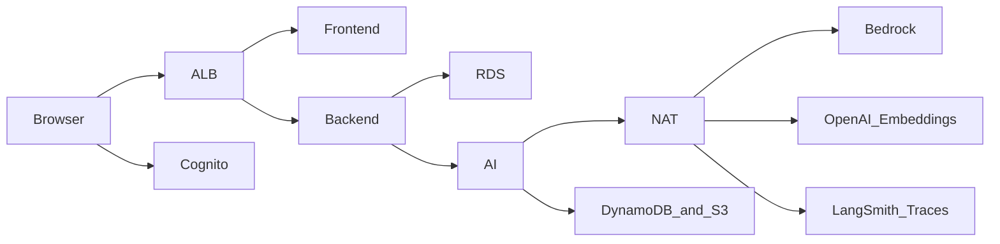

# Circini Migration Agent — AWS Deployment Guide

> **Version**: 6.1 | **Updated**: November 3, 2026
> **Audience**: HNZ cloud engineers and application operators
> **Basis**: Live reference deployment and repository commit c491105; replaces the August architecture proposal
> **Verification**: AWS inventory checked November 3, 2026; 8 functional checks passed and 1 failed

## 1. Current implementation and evidence

The application has a CloudFormation-based AWS deployment implemented in this repository. GitHub Actions builds images, provisions infrastructure, runs schema convergence, replaces ECS tasks and executes functional checks. This guide describes that implementation and a manual deployment route for an HNZ-owned account. It does not certify that an HNZ environment has already been deployed.

Local AWS credentials were invalid/expired, so verification used the existing GitHub OIDC deployment role. A fresh read-only AWS inventory succeeded on November 3, 2026. The reference deployment is in account 026146807914, region ap-southeast-2, at migration-agent.uat.signify.net.nz. This is the existing reference environment, not evidence of an HNZ-owned deployment.

| Topic | Implemented behavior |
|---|---|
| Infrastructure as code | CloudFormation, with four core stacks |
| Compute | Three ECS Fargate application services; no Keycloak service |
| Identity | Amazon Cognito with generic OIDC verification in the backend |
| Provider | Live: Bedrock GPT-OSS 120B in Sydney. Workflow fallback: OpenAI |
| Bedrock configuration | GPT-OSS 120B with regional host, region and bearer-key validation |
| Embeddings with Bedrock | OpenAI, explicitly set by the application template |
| Availability baseline | One task per service; single-AZ RDS |
| Business hours | Enabled live; always deployed by the standard deployment workflow |
| Agent tracing | Enabled live to api.smith.langchain.com; not an AWS-only data path |
| Image tag protection | All three live ECR repositories are MUTABLE; scan-on-push is enabled |
| Clinical data and voice | Unavailable; startup rejects PHI mode and voice enablement |
| Fresh functional suite | Eight checks passed; My Files reuse/output workflow did not pass full verification |

The earlier guide's Keycloak architecture, four running application services, pending OIDC implementation and unresolved IaC choice are superseded. The HNZ PDF's CloudFormation approach is consistent with the repository, but some sizing, scheduling and default-provider descriptions needed correction.

Source repository: [shankasf/small_migration](https://github.com/shankasf/small_migration).

### Verified live reference snapshot

Inventory: [GitHub run 41578571636](https://github.com/shankasf/small_migration/actions/runs/41578571636). Functional checks: [GitHub run 41578529716](https://github.com/shankasf/small_migration/actions/runs/41578529716). Supplemental runtime evidence: [GitHub run 41578846233](https://github.com/shankasf/small_migration/actions/runs/41578846233). The workflow evidence artifacts contain the detailed checks. These are point-in-time results, not a continuous availability guarantee.

| Component | Observed live on November 3, 2026 |
|---|---|
| Core infrastructure | Network CREATE_COMPLETE; data, Cognito and app UPDATE_COMPLETE |
| Additional stacks | GitHub OIDC, business-hours and testing stacks exist |
| Application images | frontend/backend/ai-service all use sha-c491105 |
| Service revisions | frontend:58, backend:58, ai-service:57; each 1 running / 1 desired; rollouts COMPLETED |
| ALB targets | Frontend and backend healthy; 660-second idle timeout; backend cookie stickiness enabled |
| Database | PostgreSQL 16.13; db.t4g.small; encrypted 20 GiB; private; single-AZ; 7-day backups |
| Identity | Cognito; TOTP MFA ON; admin/analyst/auditor groups; administrator-only signup; localhost callbacks remain |
| Model and embeddings | Bedrock GPT-OSS 120B in ap-southeast-2; OpenAI embeddings at api.openai.com |
| Traces | AGENT_TRACING_ENABLED=true; LangSmith endpoint configured |
| Durable agent state | DynamoDB checkpoints with TTL enabled; long-term memory TTL disabled |
| Audit bucket | AES256 encryption; versioning; public access blocked; Object Lock enabled; no lifecycle policy |
| Checkpoint bucket | AES256; public access blocked; expiry rules at 30 days for tagged objects and 35 days globally |
| Logs | /ecs/circini has no configured retention period |
| ECR | Three repositories; scan-on-push enabled; tags MUTABLE |
| Alerts | Five alarms in OK state; SNS topic has zero confirmed or pending subscriptions |
| Placement | Application tasks occupy both AZs; the database remains single-AZ |
| Public endpoint | Frontend and backend health HTTP 200; HTTP redirects to HTTPS; TLS certificate valid |

Fresh functional regression results, including the file-library failure, are recorded in section 6. An additional testing stack shares the reference ALB and has separate host rules; it is not an extra production application service.

## 2. Deployed topology defined by the templates

<!-- pdf-diagram: aws-topology -->




The browser connects to an Application Load Balancer. The ALB routes frontend traffic to port 5173 and backend/API traffic to port 3001. The backend calls the AI service on port 8084 through ECS Service Connect using an internal API key. There is no public ALB listener rule for the AI service.

The network template defines VPC 10.20.0.0/16, two public subnets, two private application subnets and two private data subnets across two availability zones. The ALB and a single NAT gateway sit in public subnets; Fargate tasks have no public IPs; RDS is not publicly accessible. The database security group accepts PostgreSQL traffic from the application security group. The live application security group permits all outbound protocols to 0.0.0.0/0; provider-host checks in application code do not constitute a network egress allowlist.

Only the backend owns application database access. Agent checkpoints and long-term memory use DynamoDB, with S3 checkpoint payload storage. Audit records are also archived to S3. Secrets Manager supplies container secrets at task startup. Backend and AI tasks include ADOT collector sidecars; collector presence does not prove successful telemetry delivery.

| Task family | vCPU | Task memory | Normal count |
|---|---|---|---|
| circini-frontend | 0.25 | 512 MiB | 1 |
| circini-backend | 0.5 | 2048 MiB | 1 |
| circini-ai-service | 0.5 | 2048 MiB | 1 |
| circini-schema-sync | 0.5 | 1024 MiB | One-off per release |

The running application task reservations total 1.25 vCPU and 4.5 GiB. These are task-level allocations, including sidecars where present. Scheduled closed hours can reduce service desired counts to zero. The ALB idle timeout is 660 seconds and the backend target group enables stickiness for Socket.IO.

## 3. Stack inventory and prerequisites

| Stack | Template | Role |
|---|---|---|
| circini-network | deploy/aws/network.yaml | VPC, subnets, routing, NAT and security groups |
| circini-data | deploy/aws/data.yaml | RDS PostgreSQL and eleven application secrets |
| circini-cognito | deploy/aws/cognito.yaml | User pool, SPA client, groups and hosted domain |
| circini-app | deploy/aws/app.yaml | ECS, ALB, IAM roles, logs, S3, DynamoDB and alarms |
| circini-business-hours | deploy/aws/business-hours.yaml | Listener gate, scheduler, controller and maintenance lease |
| circini-github-oidc | deploy/aws/github-oidc.yaml | GitHub OIDC provider/deployment role bootstrap |

There are four core stacks, plus scheduling and GitHub bootstrap stacks. The scheduling template is compiled and deployed by scripts/deploy-business-hours.py. Other testing infrastructure in the repository is separate from these application stacks.

Use a dedicated AWS account or first review the fixed circini-* resource names for collisions. The guide uses ap-southeast-2, matching the template and pipeline defaults. Confirm HNZ's storage, processing and external-provider requirements before deployment. A different region requires reviewing service/model availability and all region-specific references.

Required tools: AWS CLI v2, Git, Docker Buildx, Node 20 or later, and Python 3 with the dependencies required by the operational scripts. The operator needs permissions for the services in the templates, named IAM role creation and passing task roles. PowerUserAccess alone does not provide all required IAM permissions. Review deploy/aws/github-oidc.yaml as the implemented deployment-policy reference; its broad service permissions still require account-owner review.

Prepare an HNZ hostname, DNS access, an issued ACM certificate in the ALB's region, three ECR repositories, and provider credentials. ECR repositories are not created by the core templates. Use non-clinical migration artifacts only.

## 4. Manual deployment into a new account

Run commands in Bash from the repository root. Replace example values before execution. Confirm the AWS identity before creating resources; no command in this guide displays secret values.

### 4.1 Establish deployment settings and TLS

```bash
export AWS_REGION=ap-southeast-2
export AWS_DEFAULT_REGION="$AWS_REGION"
aws sts get-caller-identity
export ACCOUNT_ID=$(aws sts get-caller-identity --query Account --output text)
export REGISTRY="$ACCOUNT_ID.dkr.ecr.$AWS_REGION.amazonaws.com"
export APP_DOMAIN=circini.example.health.nz
export TAG="sha-$(git rev-parse --short=7 HEAD)"
```

Request the certificate and create the DNS validation record returned by ACM. Certificate validation must complete before the HTTPS application deployment.

```bash
export CERTIFICATE_ARN=$(aws acm request-certificate \
  --domain-name "$APP_DOMAIN" --validation-method DNS \
  --query CertificateArn --output text)
aws acm describe-certificate --certificate-arn "$CERTIFICATE_ARN" \
  --query 'Certificate.DomainValidationOptions[].ResourceRecord'
# Add the returned CNAME to the authoritative DNS zone, then:
aws acm wait certificate-validated --certificate-arn "$CERTIFICATE_ARN"
```

The template can serve HTTP when CertificateArn is empty. An HNZ deployment should supply an issued certificate and use HTTPS; Cognito's configured origin must match the final hostname.

### 4.2 Create registries; build and push images

For a new account, create the repositories once. For existing repositories, inspect their settings rather than recreating them. The commands below request immutable tags for a new account. The existing live repositories are MUTABLE, despite older documentation claiming immutable tags. Release-specific tag names alone do not prevent overwrite; verify image digests before relying on a rollback tag. No ECR settings were changed during this verification.

```bash
for service in frontend backend ai-service; do
  aws ecr create-repository --repository-name "circini-$service" \
    --image-scanning-configuration scanOnPush=true \
    --image-tag-mutability IMMUTABLE
done
aws ecr get-login-password | docker login \
  --username AWS --password-stdin "$REGISTRY"
node services/frontend/scripts/prepare-api-docs.mjs
for service in frontend backend ai-service; do
  docker buildx build --platform linux/amd64 \
    -t "$REGISTRY/circini-$service:$TAG" \
    -f "services/$service/Dockerfile" "services/$service" --push
done
```

RuntimePlatform is not explicitly set in the task definitions. Build linux/amd64 images, including when working from an ARM laptop. Manual builds do not automatically execute the CI security and evaluation gates; run the repository's CI checks before release.

### 4.3 Create network, database and identity

```bash
aws cloudformation deploy --stack-name circini-network \
  --template-file deploy/aws/network.yaml --no-fail-on-empty-changeset
aws cloudformation deploy --stack-name circini-data \
  --template-file deploy/aws/data.yaml --no-fail-on-empty-changeset \
  --parameter-overrides SeedAdminEmail=circini-admin@example.health.nz
aws cloudformation deploy --stack-name circini-cognito \
  --template-file deploy/aws/cognito.yaml --no-fail-on-empty-changeset \
  --parameter-overrides AppUrl="https://$APP_DOMAIN"
```

RDS PostgreSQL 16 uses db.t4g.small, 20 GiB gp3 storage, encryption, seven-day automated backup retention and MultiAZ=false. Stack dependencies use CloudFormation exports; complete these stacks before deploying circini-app.

### 4.4 Populate provider secrets before application startup

The data stack creates six automatically populated records: db-master, database-url, jwt-secret, internal-api-key, integration-encryption-key and seed-admin, all under circini/. Five additional records require operator values when used: openai-api-key, bedrock-api-key, azure-openai-api-key, github-oauth and gitlab-oauth. Inspect required record formats before populating integrations.

For the Bedrock route below, supply both Bedrock inference and OpenAI embedding keys. Use protected local files, outside the repository, and remove temporary copies after secure provisioning. The file contents must be the key itself, without an unintended trailing newline.

```bash
aws secretsmanager put-secret-value --secret-id circini/bedrock-api-key \
  --secret-string file:///secure/path/bedrock-key.txt >/dev/null
aws secretsmanager put-secret-value --secret-id circini/openai-api-key \
  --secret-string file:///secure/path/openai-key.txt >/dev/null
```

Secrets are injected into container environment variables at task startup; they are not hardcoded secret values in the templates. Secret rotation therefore requires replacing affected tasks. Rotating RDS credentials also requires coordinating the database-url record, whose password is assembled during stack deployment; do not assume an unchanged stack redeploy will refresh it.

### 4.5 Deploy the application with explicit Bedrock settings

This manual HNZ example deliberately selects Bedrock and disables LangSmith export. The pipeline fallback remains OpenAI. Confirm model availability and approved provider access in the target account and region first.

```bash
aws cloudformation deploy --stack-name circini-app \
  --template-file deploy/aws/app.yaml \
  --capabilities CAPABILITY_NAMED_IAM --no-fail-on-empty-changeset \
  --parameter-overrides \
    ImageTag="$TAG" AuthMode=oidc \
    AppDomain="$APP_DOMAIN" CertificateArn="$CERTIFICATE_ARN" \
    LlmProvider=bedrock BedrockRegion="$AWS_REGION" \
    BedrockModel=openai.gpt-oss-120b-1:0 \
    ApprovedLlmHost="bedrock-runtime.$AWS_REGION.amazonaws.com" \
    ProcessingRegion="$AWS_REGION" LangSmithSecretArn=''
```

The AI service refuses startup if the Bedrock host, region, processing region, model or bearer-key configuration fails validation. The accepted Bedrock model is openai.gpt-oss-120b-1:0.

Important template defaults are AuthMode=local, LlmProvider=openai, ProcessingRegion=unverified and a stale ImageTag. Pass these values explicitly; the workflow separately defaults authentication to oidc. Do not deploy the bare application template expecting the HNZ configuration.

### 4.6 Initialize schema and replace tasks

The backend health endpoint is database-independent. ECS/ALB health alone does not establish that the schema exists or the application works. The standalone schema task uses Prisma db push, which converges schema and is not a versioned migration history. Review schema changes and backups before running it against an existing database.

```bash
export APP_SUBNETS=$(aws cloudformation list-exports \
  --query "Exports[?Name=='circini-AppSubnets'].Value" --output text)
export APP_SG=$(aws cloudformation list-exports \
  --query "Exports[?Name=='circini-SgApp'].Value" --output text)
export SCHEMA_TASK=$(aws ecs run-task \
  --cluster circini-demo --launch-type FARGATE \
  --task-definition circini-schema-sync \
  --network-configuration \
  "awsvpcConfiguration={subnets=[$APP_SUBNETS],securityGroups=[$APP_SG],assignPublicIp=DISABLED}" \
  --query 'tasks[0].taskArn' --output text)
aws ecs wait tasks-stopped --cluster circini-demo --tasks "$SCHEMA_TASK"
export SCHEMA_EXIT=$(aws ecs describe-tasks --cluster circini-demo \
  --tasks "$SCHEMA_TASK" \
  --query "tasks[0].containers[?name=='schema-sync'].exitCode" --output text)
[ "$SCHEMA_EXIT" = 0 ] || { echo 'Schema task failed'; exit 1; }
for service in backend ai-service frontend; do
  aws ecs update-service --cluster circini-demo --service "$service" \
    --force-new-deployment >/dev/null
done
python3 scripts/wait-production-stable.py
```

Check run-task failures if no valid task ARN is returned. The steady-state script and production verification scripts use the repository's fixed circini resource conventions.

### 4.7 Configure DNS and create the first administrator

Retrieve the ALB DNS name and point the chosen hostname to it. For a conventional external DNS provider, use a CNAME at the application subdomain; Route 53 can use an ALB alias.

```bash
aws cloudformation describe-stacks --stack-name circini-app \
  --query "Stacks[0].Outputs[?OutputKey=='AlbDnsName'].OutputValue" \
  --output text
export USER_POOL_ID=$(aws cloudformation list-exports \
  --query "Exports[?Name=='circini-UserPoolId'].Value" --output text)
export ADMIN_EMAIL=circini-admin@example.health.nz
aws cognito-idp admin-create-user --user-pool-id "$USER_POOL_ID" \
  --username "$ADMIN_EMAIL" \
  --user-attributes Name=email,Value="$ADMIN_EMAIL" \
    Name=email_verified,Value=true >/dev/null
aws cognito-idp admin-add-user-to-group --user-pool-id "$USER_POOL_ID" \
  --username "$ADMIN_EMAIL" --group-name admin
```

Cognito requires TOTP MFA and allows administrator invitations only. Application roles derive from the admin-controlled cognito:groups claim. The seed-admin secret is not used under AUTH_MODE=oidc. The SPA client contains localhost callback/logout URLs in both the template and the live user-pool client; review these before an HNZ production release. The current backend also implements administrator-triggered Cognito email invitations. First-admin bootstrapping still requires an authorized Cognito administrator.

## 5. GitHub Actions deployment route

The real workflow is .github/workflows/deploy.yml. It runs on GitHub-hosted ubuntu-latest runners and assumes the AWS deployment role through GitHub OIDC. Bootstrap deploy/aws/github-oidc.yaml with GitHubOrg and GitHubRepo for the HNZ fork; use ExistingProviderArn if an OIDC provider already exists. CAPABILITY_NAMED_IAM is required.

Set AWS_DEPLOY_ROLE_ARN, AWS_REGION, APP_DOMAIN, CERTIFICATE_ARN and AUTH_MODE=oidc as repository variables. For Bedrock, also set LLM_PROVIDER=bedrock, BEDROCK_REGION, BEDROCK_MODEL, APPROVED_LLM_HOST and PROCESSING_REGION to match section 4.5. Without the provider override, the workflow selects OpenAI. Permanent provider credentials belong in Secrets Manager. The workflow supports temporary bootstrap secrets for selected integrations; remove these after provisioning.

The workflow gates on CI/evaluations, builds and pushes images, applies CloudFormation stacks, preflights security schema/provider access, runs schema-sync, replaces services, waits for stability, smoke-tests and executes functional verification scripts. It also deploys and reconciles the business-hours stack, then releases its maintenance lease. Passing a manual deployment does not demonstrate that these pipeline gates ran.

### Business hours: an explicit HNZ decision

The controller schedules weekday Auckland business hours, 08:30 to 19:00, with earlier RDS/task startup. It follows the configured Pacific/Auckland timezone and has no public-holiday calendar. Outside the open window, the listener gate returns HTTP 503 for matching paths and the controller scales application compute down.

The manual route in section 4 does not install this stack. The standard GitHub deployment workflow does install it unconditionally. For an HNZ 24/7 pipeline, change that workflow behavior and reconcile any already-installed scheduler/gate; leaving an existing stack active can continue to close the application.

The business-hours template hardcodes migration-agent.uat.signify.net.nz as its gate host. Replace that host with the HNZ hostname before using the scheduling path. Deploy the compiled template through the repository helper, not the raw template with an uncompiled controller.

```bash
python3 scripts/deploy-business-hours.py
python3 scripts/manage-business-hours.py status
python3 scripts/manage-business-hours.py hold --owner hnz-maintenance --wait
# Perform maintenance and verification, then restore the schedule:
python3 scripts/manage-business-hours.py release --owner hnz-maintenance
```

Maintenance leases are bounded, with a maximum three-hour window. A closed-hours 503 is deliberate behavior, but it still interrupts API callers and webhooks.

## 6. Verification and handover evidence

### Scope and limits of this live verification

The smoke script's image-tag check rejects :latest but does not enforce ECR tag immutability. The separate live ECR API inspection found all three repositories MUTABLE; passing smoke tests must not be described as proof of immutable rollback tags.

The live audit authenticated through GitHub OIDC, read AWS configuration and inspected running task digests without reading or exporting secret values. All eleven core secret records and the optional LangSmith secret exist; metadata existence does not prove unused integration credentials are valid.

The WAF association query and Bedrock invocation-logging query were denied by the deployment role. Those live controls remain unverified; absence from templates is not proof of absence account-wide. Secrets Manager ListSecrets was also denied, but DescribeSecret verified the known records individually. SNS ListSubscriptionsByTopic was denied, but GetTopicAttributes independently verified zero confirmed/pending subscribers.

Interactive Cognito password/TOTP login, email invitation delivery, end-to-end alert delivery, backup restoration, disaster recovery, provider retention/account approvals, connected Snowflake/dbt Cloud/GitLab operations and receipt of LangSmith/OTel telemetry were not proven by this run. Configured MFA and backups are not substitutes for those operational tests. ProviderApprovalReference is empty in the live application stack; an external approval decision cannot be inferred from deployment parameters.

### Fresh functional checks

The fresh full run completed with eight passing checks and one failing check. It is not an all-green release certification. The first file-library run failed during cross-chat reuse of an exact uploaded SQL version. A targeted rerun passed that phase, then failed because the expected generated SQL output was not found in My Files. Upload version creation and preservation passed. Full output versioning, cross-chat output reuse and the remaining file-library assertions are not validated by these results.

| Verification check | Fresh result |
|---|---|
| Public and AWS security smoke | PASS: 19 assertions; independent public probe also passed 16 assertions |
| GitHub integration boundaries | PASS: connection initiation, signed/unsigned webhook handling, callback and anonymous-access checks |
| Agent/tool APIs | PASS: 15 agents, 12 tools, upload/download, session isolation, source grants, auditing and revocation |
| Chat-history and file search | PASS: semantic search, cross-chat recall, follow-up and file delivery |
| Feedback rubric | PASS: persistence, aggregate/filter and score-clearing behavior |
| Impact analysis | PASS: Bedrock GPT-OSS, explicit source grants, grounded report and read-only scope |
| SQL-generation graph | PASS: clarification pause/resume, generation, structured drafts, macro revision and metering |
| Long-term memory | PASS: cross-chat recall, explicit erasure and synthetic-fixture cleanup |
| My Files / file library | FAIL: initial cross-chat reference check; targeted rerun failed at generated-output discovery |

Targeted diagnostic evidence: [GitHub run 41580128697](https://github.com/shankasf/small_migration/actions/runs/41580128697). The safe assertion was: "Generated output was not indexed in My Files." This means the expected output was not discoverable in that test; it does not by itself establish whether generation, indexing or test expectations caused the absence. The earlier exact-reference failure was not reproduced in the rerun. Treat this workflow as an open validation issue, not as fully working. No application fix was deployed as part of this documentation audit.


The checks use short-lived API credentials and synthetic fixtures in the live reference environment; they do not demonstrate a human completing Cognito MFA. The existing CI run on November 3 also passed backend and AI security tests, type checks, frontend lint, dependency auditing, secret scanning, Semgrep and CloudFormation policy checks at commit c491105. [CI evidence](https://github.com/shankasf/small_migration/actions/runs/41578151583).


Capture account identity, region, stack statuses, image tags, task revisions and provider configuration as release evidence. Confirm the final hostname publicly. Test login, MFA, role restrictions, a non-clinical chat turn, upload/search, SQL generation and download. Confirm audit delivery and alert routing. Health checks are only the first step.

```bash
aws cloudformation describe-stacks \
  --query 'Stacks[].{Stack:StackName,Status:StackStatus}' --output table
aws ecs describe-services --cluster circini-demo \
  --services frontend backend ai-service \
  --query 'services[].{Name:serviceName,Running:runningCount,Desired:desiredCount}' \
  --output table
curl --fail --silent --show-error "https://$APP_DOMAIN/" -o /dev/null
curl --fail --silent --show-error "https://$APP_DOMAIN/api/health"
```

Use the applicable scripts under scripts/verify-*-production.py for functional evidence. They launch AWS tasks and may create test artifacts or invoke paid model APIs; inspect their target configuration before using them in an HNZ account. For Bedrock graph/impact verification, set EXPECTED_LLM_PROVIDER=bedrock and EXPECTED_LLM_MODEL=openai.gpt-oss-120b-1:0. Several script defaults still refer to the reference environment or OpenAI.

The live circini-security-alerts topic has zero confirmed and zero pending subscriptions, verified using GetTopicAttributes. Its five associated alarms were in OK state, but this topic currently has no subscribers to notify. Subscribe the HNZ operations contact and verify delivery; creating alarms and a topic alone does not notify anyone. Record backup retention, restoration procedure, RPO/RTO, access ownership and the agreed release/rollback process.

## 7. Security, data handling and remaining gaps

The AI service rejects startup when guardrails are disabled, PHI_MODE is enabled, or voice is enabled. Health-PII detection is a technical guardrail, not an approval to process patient records. Limit use to approved non-clinical migration material until the required independent assessment and boundary changes are completed.

On the Bedrock path, chat inference uses the configured regional Bedrock endpoint, but semantic file search explicitly sends embedding input to api.openai.com. Bedrock selection therefore does not establish an AWS-only or region-only processing boundary. Obtain approval for that egress or change the embedding configuration/implementation. Clearing EMBEDDING_PROVIDER on Bedrock disables the supported semantic-search route rather than moving it to Bedrock.

LangSmith export is enabled when LangSmithSecretArn is supplied; the standard workflow can supply it from a configured LangSmith key. Otherwise agent trace export remains off. In the live reference deployment it is ON: AGENT_TRACING_ENABLED=true and the configured destination is https://api.smith.langchain.com. Delivery to LangSmith was not independently confirmed. Redaction does not eliminate the need to approve an external trace destination. An HNZ configuration that requires tracing off must explicitly set LangSmithSecretArn to an empty string and remove/disable the workflow key path. On an existing stack, omitting a parameter from an update can preserve its previous value; omission alone is not a reliable disable operation.

CloudWatch logs, application activity records, S3 audit archives and provider retention are separate data stores with separate lifecycle policies. Application code retains chats, uploads, outputs, AI activity, usage and audits indefinitely with automaticDeletion=false. The live checkpoint DynamoDB table has TTL enabled; the memory table has no TTL. Checkpoint-bucket expiry does not delete these database records. Object Lock is enabled on the audit bucket, and application writes request per-object legal holds; existing individual object holds were not inspected.

| Area | Current code/template position | HNZ release action |
|---|---|---|
| Availability | Single task per service; single-AZ database; one NAT | Agree availability needs; review Multi-AZ and redundancy |
| Logging | Live /ecs/circini has no retention; ALB access logs are disabled | Set an approved retention policy |
| WAF | No core template resource; live association query denied | Have an authorized operator verify association and policy |
| Backend scaling | Socket.IO state in-process; sticky sessions enabled | Add a shared adapter/state design before scaling replicas |
| Schema | Prisma db push one-off task | Review changes and backups; plan versioned migrations |
| Recovery | Live 7-day backups; RDS deletion protection is false; restore not tested | Perform and evidence a restore test; agree RPO/RTO |
| Rollback | No ECS deployment circuit breaker defined | Monitor rollout and keep a known-good image tag |
| Supply chain | Live ECR tags mutable; ADOT sidecar uses latest | Plan immutable repositories and digest-pinned releases |
| My Files reuse/output | Two fresh runs failed at different phases | Diagnose generation/retrieval and repeatability before signing off |
| External processing | Live OpenAI embeddings and LangSmith tracing enabled | Agree HNZ provider, region and trace boundaries |
| Alerts | Live SNS topic has zero confirmed/pending subscriptions | Add the approved operations recipient and test delivery |
| Cost | Old documents' estimates use earlier sizing | Recalculate for 4.5 GiB task memory, schedule and usage |

An updated cost quotation is not included: the earlier approximately USD 160/month estimate should not be treated as a current quote. Model usage, NAT/data transfer, logs, storage, backups and secrets are additional cost drivers. Business hours reduce compute hours but do not remove standing ALB/NAT/storage costs.

## 8. Operations, rollback and troubleshooting

For a new release, build release-specific images with a new tag, deploy circini-app with the full approved parameter set, run the schema step as appropriate, replace services and repeat verification. For rollback, first verify the saved image digest (live tags can be overwritten), then redeploy the known-good tag while preserving the approved identity/provider/domain settings. An image rollback does not reverse database schema changes; verify compatibility first.

After secret rotation, force a new deployment of affected services and wait for stable tasks. Coordinate database password changes and database-url updates as one operation. Existing tasks retain the values injected when they started.

When a release fails, inspect ECS service events, stopped task reasons and /ecs/circini container logs. Provider-boundary errors and missing configuration can stop the AI service. Architecture mismatch, missing writable mounts, secret access failures and private-subnet egress issues can also prevent startup. Read-only application roots depend on the configured ephemeral volume mounts; the nonessential volume-init containers run as root to prepare those mounts.

If public access returns 503, inspect business-hours status and ALB target health. The public /ai/health path currently returns the SPA HTML with HTTP 200, not the internal AI health JSON. Inspect ECS/runtime health and backend-mediated functional checks to assess the AI service. If /api/health passes but application actions fail, verify schema completion, provider access, identity settings and functional tests. Do not equate healthy targets with a successful migration workflow.

## 9. Authoritative code references

The guide was reconciled against authenticated AWS API responses, public HTTPS probes and these implementation files at deployed repository commit c491105. Follow their subsequent changes when maintaining this document.

- .github/workflows/deploy.yml: build, CloudFormation, schema, rollout, verification and scheduling.
- deploy/aws/network.yaml, data.yaml, cognito.yaml and app.yaml: core infrastructure.
- deploy/aws/github-oidc.yaml: deployment identity and permissions.
- deploy/aws/business-hours.yaml and scripts/deploy-business-hours.py: compiled schedule deployment.
- scripts/business_hours_controller.py and manage-business-hours.py: schedule and maintenance operations.
- services/backend/src/middleware/auth.ts: OIDC verification and local-only admin seeding.
- services/ai-service/llm.py and config.py: provider validation and PHI/voice restrictions.
- services/ai-service/routes/file_search.py: embedding provider selection.
- services/backend/src/services/retention.ts and audit.ts: record lifecycle and S3 audit writes.
- services/backend/src/services/userInvitations.ts: administrator-triggered Cognito invitations.
- scripts/wait-production-stable.py and verify-*-production.py: release verification.

This document records implemented behavior and deployment instructions. Final HNZ acceptance requires successful deployment evidence from the target AWS account and approval of the selected data boundaries.
