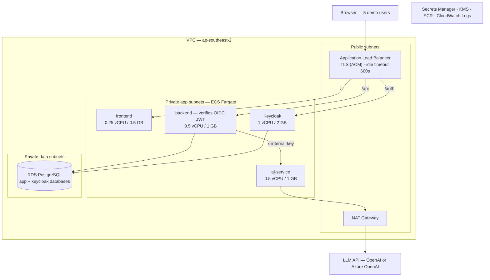

# Circini Migration Agent — AWS Demo Deployment

> **Version**: 5.0 | **Date**: August 3, 2026
> **Purpose**: Demo / test environment — 5 users, no production data
> **Region**: `ap-southeast-2` (Sydney)

---

## 1. Scope

| Parameter | Value |
|-----------|-------|
| Users | 5 concurrent, internal demo |
| Platform | ECS Fargate, 1 task per service |
| Placement | Tasks and database in private subnets |
| Availability | Single task per service — restart on failure |
| Identity | **Self-hosted Keycloak** — there is no AD or Entra tenant to federate with |
| Data | Test data only |
| Sizing basis | The retired K3s deployment's resource limits (git history) + runtime limits in code |

---

## 2. Status

| # | Item | Status |
|---|------|--------|
| 1 | **RBAC / user activity management** | **Done (live).** Three roles (admin / analyst / auditor), mandatory login, row-level session scoping, per-user daily and monthly token caps, full user lifecycle via the admin portal. Every action lands in the audit trail |
| 2 | **Model provider flexibility** | **Done (config-gated).** Provider, endpoint and model are configuration — switching to Azure OpenAI or another hosted model is an env change, no code change |
| 3 | **OTEL telemetry** | **Instrumentation done, collector pending.** Both services emit traces and metrics; export activates as soon as `OTEL_EXPORTER_OTLP_ENDPOINT` points at a collector. Collector choice left open to match the target environment |
| 4 | **Security scans** | **Run, minor remediation in flight.** Dependency scans complete and evidenced in the repo. Remaining: replacing the `xlsx` library (upstream advisories, no patch available — moving to `exceljs`) and two dev-only findings that do not ship to runtime |
| 5 | **AI guardrails** | **Done (live).** PII and identifier detection, DOB and contact redaction before egress, prompt-injection detection, PHI-mode flag; blocked attempts raise critical audit events. Verified end-to-end with live calls |

---

## 3. Architecture

<!-- pdf-diagram: aws-topology -->

The ALB publishes `/`, `/api` and `/auth`. The browser never calls `/ai`, so the AI service needs
no listener rule and is reachable only from the backend.

### 3.1 Identity — Keycloak

There is no AD or Entra tenant to federate with, so identity is self-hosted. Keycloak runs as a
fourth Fargate task and issues OIDC tokens; the backend verifies them against Keycloak's JWKS.

| Concern | Approach |
|---------|----------|
| Flow | OIDC Authorization Code + PKCE, same as the Entra design |
| Realm | One realm, one public client for the SPA, one confidential client for the backend |
| Roles | Keycloak realm roles `admin` / `analyst` / `auditor` emitted in the `roles` claim — the backend's existing claim-to-role mapping consumes them unchanged |
| MFA | Keycloak's built-in TOTP, enabled per realm — no external IdP needed |
| Database | Its own `keycloak` database on the same RDS instance |
| Hostname | Path-routed at `/auth` (`KC_HTTP_RELATIVE_PATH=/auth`), or a dedicated `auth.` subdomain |
| Admin console | Restricted to an IP allowlist, or not exposed through the ALB at all |

**One code change is required.** `middleware/auth.ts:28` hardcodes the JWKS URL and issuer to
`login.microsoftonline.com`, so `AUTH_MODE=entra` cannot point at Keycloak as-is. The fix is small
and well-scoped: add `AUTH_MODE=oidc` reading `OIDC_ISSUER`, `OIDC_JWKS_URL` and `OIDC_AUDIENCE`.
Everything downstream — signature and audience verification, group/role mapping, user upsert — is
provider-agnostic already and needs no change. The frontend swaps MSAL for a generic OIDC client.

---

## 4. AWS Services Required

| Service | Why |
|---------|-----|
| **ECS Fargate** | Runs the 4 containers. No EC2 to patch |
| **Keycloak** (on Fargate) | Self-hosted OIDC identity provider — logins, MFA, roles. No AD or Entra tenant exists to federate with (§3.1) |
| **ECS Service Connect** | Service-to-service DNS — `AI_SERVICE_URL` and `BACKEND_URL` resolve by name. Kubernetes gives this for free; ECS does not. **Required** |
| **ECR** | Image registry. Replaces GHCR so pulls use an IAM role, not the `ghcr-pull` credential |
| **Application Load Balancer** | TLS termination, path routing (`/`, `/api`, `/auth`), and the **sticky sessions** Socket.IO needs — it falls back to long-polling, so requests must land on the same task. **Idle timeout 660s**: a chat turn can run 10 minutes |
| **VPC** | 2 public + 2 private subnets, NAT Gateway, 3 security groups |
| **RDS PostgreSQL** | Two databases on one instance: the app (users, sessions, messages, audit events, usage records, uploaded file and output content) and Keycloak's realm store |
| **Secrets Manager + KMS** | 10 secrets injected at task start; encryption at rest for RDS and backups |
| **Certificate Manager** | TLS certificate. Replaces cert-manager / Let's Encrypt |
| **CloudWatch Logs** | Only way to read container stdout on Fargate — no `kubectl logs` |
| **IAM** | Task execution role, task role, GitHub OIDC deploy role — no static keys |
| **Route 53** | DNS to the ALB. Optional — Hostinger can CNAME instead |

### Optional add-ons

| Add-on | Buys | Cost |
|--------|------|------|
| AWS WAF on the ALB | OWASP rule set, rate limiting, IP allowlist | +$12/mo |
| OTel Collector sidecar | Activates the telemetry in item 3 | +$12/mo |
| Multi-AZ RDS | Database failover | +$16/mo |
| GuardDuty | Threat detection | +$6/mo |
| ElastiCache Redis | Lets the backend scale past 1 replica | +$17/mo |

---

## 5. Sizing & Network

| Task | vCPU | Memory | Count | Port | Health check |
|------|------|--------|-------|------|--------------|
| frontend | 0.25 | 0.5 GB | 1 | 5173 | `/` |
| backend | 0.5 | 1 GB | 1 | 3001 | `/api/health` |
| ai-service | 0.5 | 1 GB | 1 | 8084 | `/ai/health` |
| Keycloak | 1.0 | 2 GB | 1 | 8080 | `/auth/health/ready` |
| schema-sync | 0.5 | 1 GB | on deploy | — | exit 0 |
| **Total running** | **2.25** | **4.5 GB** | | | |

Memory is driven by in-process buffers, not request rate: multer holds 10 files × 10 MB per upload
in RAM plus a parsed copy, so 1 GB is the backend floor. Both health paths are auth-exempt, so the
ALB can reach them.

| Subnet | Count | Contents | Internet route |
|--------|-------|----------|----------------|
| Public | 2 | ALB, NAT Gateway | Internet Gateway |
| Private — app | 2 | Fargate tasks | Via NAT |
| Private — data | 2 | RDS | None |

Two AZs are unavoidable — the ALB requires ≥2 subnets and RDS requires a ≥2-AZ subnet group. The
workload runs in one.

| Security group | Inbound | Outbound |
|----------------|---------|----------|
| `sg-alb` | 443, 80 from 0.0.0.0/0 | To `sg-app` on 5173, 3001, 8080 |
| `sg-app` | From `sg-alb` on 5173/3001/8080; 8084, 3001 and 8080 from `sg-app` | 5432→`sg-data`, 443→internet |
| `sg-data` | 5432 from `sg-app` | None |

`sg-app` allows 3001 from itself because the ai-service posts progress logs back to the backend.

**Secrets:** `OPENAI_API_KEY`, `INTERNAL_API_KEY`, `JWT_SECRET`, `DATABASE_URL`,
`SEED_ADMIN_EMAIL`, `SEED_ADMIN_PASSWORD`, plus Keycloak's `KC_DB_PASSWORD`,
`KEYCLOAK_ADMIN_PASSWORD` and the backend's `OIDC_CLIENT_SECRET`. Add 4 × `AZURE_OPENAI_*` if the
model provider is switched.

---

## 6. Cost — ap-southeast-2

Excludes LLM API spend.

| Line item | Cost |
|-----------|------|
| Fargate — app tasks, 1.25 vCPU / 2.5 GB, 24×7 | ~$54 |
| Fargate — Keycloak, 1 vCPU / 2 GB, 24×7 | ~$43 |
| NAT Gateway + data | ~$48 |
| Application Load Balancer | ~$22 |
| RDS `db.t4g.small` + 20 GiB gp3, backups (two databases) | ~$34 |
| CloudWatch Logs | ~$8 |
| Secrets Manager, KMS, ECR, Route 53, CloudTrail | ~$10 |
| **Total** | **~$219/mo** |

| Variant | Cost | Trade-off |
|---------|------|-----------|
| **Amazon Cognito instead of Keycloak** | **~$160/mo** | Managed OIDC, free under 50k monthly users. Drops the Keycloak task and the RDS bump — but is AWS-only, so it does not travel to another environment |
| Tasks in public subnets, no NAT | **~$182/mo** | Drops the NAT Gateway; tasks get public IPs but no inbound path except from the ALB |
| Fargate Spot | **~$151/mo** | Tasks reclaimed on 2-minute notice |
| Single `t3.medium` EC2 + docker compose | **~$45/mo** | No ALB or RDS; Keycloak and Postgres on the box. Closest to the current K3s setup; does not exercise the AWS architecture |

LLM API spend is separate and will exceed all of the above.

---

## 7. Constraints

| # | Constraint | Impact at 5 users | Fix |
|---|-----------|-------------------|-----|
| 1 | Backend pinned to 1 replica — Socket.IO holds connection state in-process, no Redis adapter | None. Brief connection gap per deploy | ElastiCache + `@socket.io/redis-adapter` |
| 2 | `prisma db push` is an init container; Fargate has none | Standalone ECS task in the pipeline, command `node node_modules/prisma/build/index.js db push --skip-generate`, `HOME=/tmp` | Convert to `prisma migrate deploy` — `db push` can drop columns to converge a schema |
| 3 | Containers run read-only root | Writable mounts needed: `/tmp` (all), `/var/cache/nginx` (frontend), `/data/outputs` (ai-service — it `mkdir`s at startup and will not boot without it) | Fargate ephemeral volumes |
| 4 | Deploy job runs on a self-hosted K3s runner | Must move to a GitHub-hosted runner | Use the OIDC role |

---

## 8. Decisions

| # | Decision | Impact |
|---|----------|--------|
| 1 | **Keycloak or Amazon Cognito?** | Both are OIDC and both need the same `AUTH_MODE=oidc` change (§3.1). Keycloak costs ~$59/mo more but is portable to any environment; Cognito is free at this scale and AWS-only |
| 2 | Replace the K3s deployment, or run alongside? | Whether `migration.callsphere.site` moves to Route 53 and existing PostgreSQL data migrates |
| 3 | Private subnets + NAT, or public subnets? | $48/mo for the cleaner network posture (§6) |
| 4 | Which optional add-ons (§4)? | WAF, OTel collector and Multi-AZ are the three worth considering |
| 5 | Collector target for OTEL | Sets `OTEL_EXPORTER_OTLP_ENDPOINT`; no code change |
| 6 | Terraform, CDK or CloudFormation | Build as code either way |

**Prerequisites:** AWS account with billing alerts · region confirmed · DNS zone control · LLM API
key · the `AUTH_MODE=oidc` backend change and matching frontend OIDC client (§3.1).
