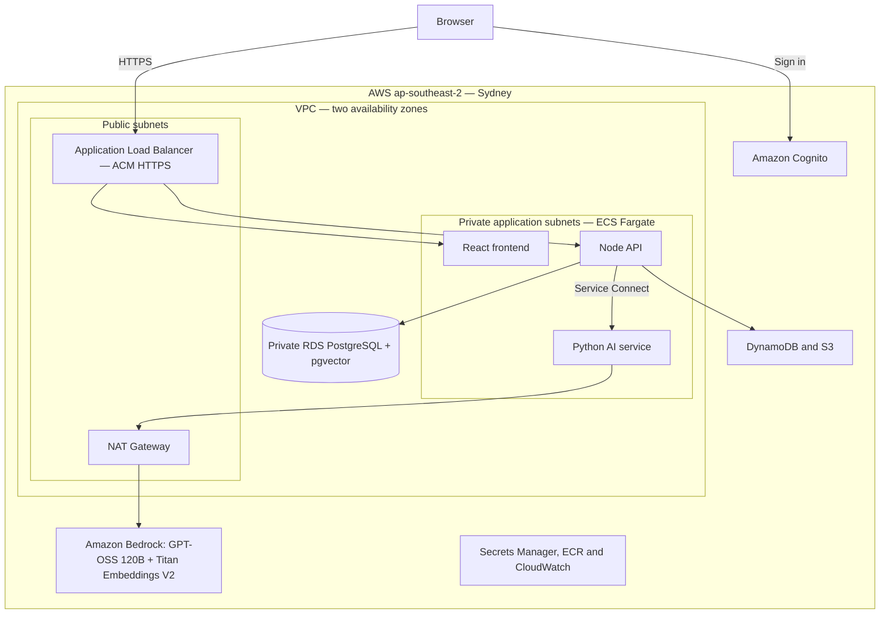

# Circini Migration Agent — AWS Deployment Guide

Prepared for Healthcare New Zealand · November 4, 2026

Deploy a fresh Circini environment using Amazon Bedrock for chat inference and Amazon Titan Text Embeddings V2 for semantic search.

## Deployment profile

| Component | Configuration |
|---|---|
| Region | ap-southeast-2 — Sydney |
| Chat model | Bedrock: openai.gpt-oss-120b-1:0 |
| Embeddings | Bedrock: amazon.titan-embed-text-v2:0 |
| Vector format | 1,024 dimensions, normalized |
| Compute | ECS Fargate: frontend, backend and ai-service |
| Database | Private RDS PostgreSQL with pgvector |
| Identity | Amazon Cognito; administrator invitations and TOTP MFA |
| Application telemetry | CloudWatch and the deployed AWS observability components |
| Agent trace export | Disabled in this new-environment profile |

The flowchart describes this target configuration. Both inference and embeddings use Amazon Bedrock. This document does not change or certify the trace-export settings of the existing reference deployment.

Use approved non-clinical migration material. Technical deployment alone does not establish approval to process patient data.

<!-- pagebreak -->

## Architecture and data flow

<!-- pdf-diagram: aws-topology -->


The browser accesses the frontend and API through the load balancer. The backend calls the private AI service using an internal key. Bedrock receives inference and embedding requests through NAT. File and chat vectors are stored in PostgreSQL; agent state and memory also use the configured AWS stores.

This diagram covers the core deployment. Optional repository and data-platform integrations are configured separately. NAT remains general outbound connectivity; the diagram is not a network egress allowlist.

<!-- pagebreak -->

## 1. Prepare the account and repository

Use a dedicated AWS account for the simplest fresh installation. The templates contain fixed circini-* names and exports. A second environment in the same account requires coordinated changes to resource names, policies, workflows and scripts; changing stack names alone is insufficient.

Install Git, AWS CLI v2, Docker with Buildx, Node.js 20 or later and Python 3. Install GitHub CLI for the optional pipeline route. Bootstrap requires permission to create and pass IAM roles; PowerUser access alone may be insufficient.

Use a separate repository or parameterized workflows for a new environment so existing production deployment variables are not redirected.

```bash
git clone https://github.com/shankasf/small_migration.git
cd small_migration
git checkout main
git pull --ff-only
aws login --profile circini-new --region ap-southeast-2
export AWS_PROFILE=circini-new
export AWS_REGION=ap-southeast-2
export AWS_DEFAULT_REGION="$AWS_REGION"
aws sts get-caller-identity
```

Confirm the returned account is the new target, then replace the example hostname and administrator email:

```bash
export ACCOUNT_ID=$(aws sts get-caller-identity \
  --query Account --output text)
export REGISTRY="$ACCOUNT_ID.dkr.ecr.$AWS_REGION.amazonaws.com"
export APP_DOMAIN=circini.example.health.nz
export ADMIN_EMAIL=circini-admin@example.health.nz
export TAG="sha-$(git rev-parse --short=7 HEAD)"
```

Run subsequent commands in Bash from the repository root. The embedding implementation is pinned to Sydney; another region requires an implementation review.

<!-- pagebreak -->

## 2. Request the HTTPS certificate

The certificate must be issued in the load balancer's region. Create the DNS validation CNAME returned by ACM, then wait for issuance.

```bash
export CERTIFICATE_ARN=$(aws acm request-certificate \
  --domain-name "$APP_DOMAIN" --validation-method DNS \
  --query CertificateArn --output text)
aws acm describe-certificate --certificate-arn "$CERTIFICATE_ARN" \
  --query 'Certificate.DomainValidationOptions[].ResourceRecord'
# Create the returned validation CNAME in your DNS provider.
aws acm wait certificate-validated \
  --certificate-arn "$CERTIFICATE_ARN"
```

## 3. Create ECR repositories and build images

Create repositories once. For existing repositories, inspect their configuration instead. Build linux/amd64 images, including on an ARM laptop.

```bash
for service in frontend backend ai-service; do
  aws ecr create-repository --repository-name "circini-$service" \
    --image-tag-mutability IMMUTABLE \
    --image-scanning-configuration scanOnPush=true
done
aws ecr get-login-password | docker login \
  --username AWS --password-stdin "$REGISTRY"
node services/frontend/scripts/prepare-api-docs.mjs
for service in frontend backend ai-service; do
  docker buildx build --platform linux/amd64 \
    -t "$REGISTRY/circini-$service:$TAG" \
    -f "services/$service/Dockerfile" "services/$service" --push
done
```

Require the repository's CI, security and image-scan checks before accepting a release. A manual Docker build does not demonstrate those checks passed. Record the release commit and image digests.

<!-- pagebreak -->

## 4. Create the base infrastructure

Deploy network, data and identity in order. Their exported values are required by the application stack. Review the fixed subnet CIDRs before creating the VPC.

```bash
aws cloudformation deploy --stack-name circini-network \
  --template-file deploy/aws/network.yaml \
  --no-fail-on-empty-changeset
aws cloudformation deploy --stack-name circini-data \
  --template-file deploy/aws/data.yaml \
  --parameter-overrides SeedAdminEmail="$ADMIN_EMAIL" \
  --no-fail-on-empty-changeset
aws cloudformation deploy --stack-name circini-cognito \
  --template-file deploy/aws/cognito.yaml \
  --parameter-overrides AppUrl="https://$APP_DOMAIN" \
  --no-fail-on-empty-changeset
```

| Stack | Creates |
|---|---|
| circini-network | VPC, two public/app/data subnet sets, routing, one NAT gateway and security groups |
| circini-data | Private PostgreSQL 16, encrypted storage, seven-day backups and application secrets |
| circini-cognito | User pool, SPA client, administrator/analyst/auditor groups and MFA configuration |

RDS is single-AZ in the template. Two subnet availability zones do not make the database highly available. Review redundancy and recovery requirements before handover.

The generated seed-admin secret applies to local authentication. This guide uses OIDC, so create the administrator in Cognito in step 9.

<!-- pagebreak -->

## 5. Configure AWS model credentials

Ensure the account can invoke both selected models in ap-southeast-2. The current application supports a Bedrock bearer key. Store a credential authorized for both models in Secrets Manager:

```bash
aws secretsmanager put-secret-value \
  --secret-id circini/bedrock-api-key \
  --secret-string file:///secure/path/bedrock-key.txt >/dev/null
```

The protected file must contain only the key. Keep credential files outside the repository and remove temporary copies after secure provisioning.

| Setting | Required value |
|---|---|
| LLM_PROVIDER | bedrock |
| BEDROCK_MODEL | openai.gpt-oss-120b-1:0 |
| BEDROCK_REGION / PROCESSING_REGION | ap-southeast-2 |
| EMBEDDING_PROVIDER | bedrock; supplied by app.yaml |
| Embedding model | amazon.titan-embed-text-v2:0; fixed in the implementation |
| Embedding endpoint | bedrock-runtime.ap-southeast-2.amazonaws.com |
| Vector size | 1,024 dimensions, normalized |

No OpenAI API key is required for this profile. Unused provider-secret records may remain in the template for other chat configurations; the Bedrock deployment does not inject the OpenAI key.

### Trace export

Set LangSmithSecretArn to an empty string explicitly, as shown in step 6. This disables agent trace export in the new environment. If using GitHub Actions, keep LANGSMITH_API_KEY unset and remove any retained key/ARN path that could enable export. Recheck the running configuration after release.

The current reference environment's tracing is a separate setting and is not disabled by this document. CloudWatch application logging remains available.

<!-- pagebreak -->

## 6. Deploy the application stack

Pass hostname, certificate, identity mode and provider settings explicitly. Template defaults alone do not select this profile.

```bash
aws cloudformation deploy --stack-name circini-app \
  --template-file deploy/aws/app.yaml \
  --capabilities CAPABILITY_NAMED_IAM \
  --no-fail-on-empty-changeset \
  --parameter-overrides \
    ImageTag="$TAG" AuthMode=oidc \
    AppDomain="$APP_DOMAIN" CertificateArn="$CERTIFICATE_ARN" \
    LlmProvider=bedrock BedrockRegion="$AWS_REGION" \
    BedrockModel=openai.gpt-oss-120b-1:0 \
    ApprovedLlmHost="bedrock-runtime.$AWS_REGION.amazonaws.com" \
    ProcessingRegion="$AWS_REGION" LangSmithSecretArn=''
```

The stack creates the ECS cluster, three services, task roles, Service Connect, load balancer, application storage, logs and the one-off schema task definition.

## 7. Initialize PostgreSQL and pgvector

Run the schema task inside the private network. The public health endpoint does not prove the schema exists.

```bash
export APP_SUBNETS=$(aws cloudformation list-exports \
  --query "Exports[?Name=='circini-AppSubnets'].Value" --output text)
export APP_SG=$(aws cloudformation list-exports \
  --query "Exports[?Name=='circini-SgApp'].Value" --output text)
export NET="awsvpcConfiguration={subnets=[$APP_SUBNETS],"
NET+="securityGroups=[$APP_SG],assignPublicIp=DISABLED}"
export SCHEMA_TASK=$(aws ecs run-task \
  --cluster circini-demo --launch-type FARGATE \
  --task-definition circini-schema-sync \
  --network-configuration "$NET" \
  --query 'tasks[0].taskArn' --output text)
aws ecs wait tasks-stopped --cluster circini-demo --tasks "$SCHEMA_TASK"
```

If run-task returns no valid task ARN, inspect its failures before waiting. Continue with the exit-code check on the next page.

<!-- pagebreak -->

## 8. Check the schema and stabilize services

```bash
export SCHEMA_EXIT=$(aws ecs describe-tasks --cluster circini-demo \
  --tasks "$SCHEMA_TASK" \
  --query "tasks[0].containers[?name=='schema-sync'].exitCode" \
  --output text)
[ "$SCHEMA_EXIT" = 0 ] || { echo 'Schema task failed'; exit 1; }
for service in backend ai-service frontend; do
  aws ecs update-service --cluster circini-demo --service "$service" \
    --force-new-deployment >/dev/null
done
python3 scripts/wait-production-stable.py
```

The schema includes separate 1,024-dimensional Titan vector columns for files and chats. A fresh installation has no old vectors to migrate. An upgrade preserves the legacy 1,536-dimensional columns while rebuilding Titan indexes; search does not mix the vector spaces.

## 9. Connect DNS and create the administrator

Read the ALB hostname and create a CNAME for the application subdomain, or the appropriate DNS alias. Then create the Cognito administrator.

```bash
aws cloudformation describe-stacks --stack-name circini-app \
  --query "Stacks[0].Outputs[?OutputKey=='AlbDnsName'].OutputValue" \
  --output text
# Point APP_DOMAIN to the returned load-balancer hostname.
export USER_POOL_ID=$(aws cloudformation list-exports \
  --query "Exports[?Name=='circini-UserPoolId'].Value" --output text)
aws cognito-idp admin-create-user --user-pool-id "$USER_POOL_ID" \
  --username "$ADMIN_EMAIL" --desired-delivery-mediums EMAIL \
  --user-attributes Name=email,Value="$ADMIN_EMAIL" \
    Name=email_verified,Value=true >/dev/null
aws cognito-idp admin-add-user-to-group --user-pool-id "$USER_POOL_ID" \
  --username "$ADMIN_EMAIL" --group-name admin
```

Open the application, complete password setup and TOTP enrollment, and verify the role. The first successful OIDC login creates the application user record needed by account-dependent checks. Confirm invitation delivery.

<!-- pagebreak -->

## 10. Verify the complete application

Verify the new environment independently. These instructions are not an acceptance certificate for an untested account.

```bash
curl -fsS -o /dev/null "https://$APP_DOMAIN/"
curl -fsS "https://$APP_DOMAIN/api/health"
bash deploy/smoke-test.sh "https://$APP_DOMAIN"
python3 scripts/verify-titan-production.py
```

The Titan check invokes the deployed provider and reports model, region, dimensions and stored-vector counts. For upgrades, it also rebuilds pending file/chat vectors. Policy-blocked content is reported separately.

| Check | Required result |
|---|---|
| ECS | Three stable services; desired count met; no pending tasks |
| Identity | Login and TOTP work; anonymous protected requests rejected |
| Embeddings | Titan V2, ap-southeast-2, 1,024 dimensions |
| Upload and search | Fresh synthetic file indexed and retrieved |
| Chat history | New messages indexed; search respects ownership |
| Agent workflow | Clarification, SQL generation, saved output and download work |
| Trace configuration | AGENT_TRACING_ENABLED=false; no LangSmith key injected |
| Operations | Logs visible; alerts delivered; backup/restore tested |

Before running account-dependent scripts, replace reference identities, including sagar@callsphere.ai, with dedicated verification users in the new environment. After preparation, scripts/verify-file-library-production.py checks upload versions, generated files, reuse and search. Other scripts cover integrations, feedback, impact analysis, the agent graph and memory.

Use synthetic material. Record account, region, commit, image digests, task revisions and results. A health response alone is insufficient.

<!-- pagebreak -->

## 11. Optional GitHub Actions deployment

Use .github/workflows/deploy.yml for repeatable releases. Before the first run, create network/data/Cognito and ECR repositories, populate the Bedrock secret and prepare the GitHub App. Agent evaluations load provider credentials before the deployment job starts.

Bootstrap OIDC for the target repository:

```bash
aws cloudformation deploy --stack-name circini-github-oidc \
  --template-file deploy/aws/github-oidc.yaml \
  --capabilities CAPABILITY_NAMED_IAM \
  --parameter-overrides GitHubOrg=YOUR_ORG GitHubRepo=YOUR_REPO
aws cloudformation describe-stacks --stack-name circini-github-oidc \
  --query "Stacks[0].Outputs[?OutputKey=='DeployRoleArn'].OutputValue" \
  --output text
```

If GitHub's OIDC provider already exists in the account, also supply ExistingProviderArn. Create the repository environment named production and set these repository variables:

| Variable | Value |
|---|---|
| AWS_DEPLOY_ROLE_ARN | Returned deploy-role ARN |
| AWS_REGION / BEDROCK_REGION / PROCESSING_REGION | ap-southeast-2 |
| APP_DOMAIN / CERTIFICATE_ARN | New hostname / issued certificate ARN |
| AUTH_MODE / LLM_PROVIDER | oidc / bedrock |
| BEDROCK_MODEL | openai.gpt-oss-120b-1:0 |
| APPROVED_LLM_HOST | bedrock-runtime.ap-southeast-2.amazonaws.com |

Keep LANGSMITH_API_KEY unset. The current pipeline requires a GitHub App even if users will not immediately connect a repository. Store appId, slug, clientId, clientSecret, privateKey and webhookSecret in circini/github-oauth, or bootstrap with the masked CIRCINI_GITHUB_APP_BOOTSTRAP_JSON secret. Use the new hostname for callback and webhook URLs.

<!-- pagebreak -->

## Pipeline startup and later releases

```bash
gh workflow run deploy.yml --ref main
gh run list --workflow deploy.yml --limit 5
```

The pipeline runs CI, agent evaluations, image builds/scans, stack deployment, schema checks, ECS stabilization, smoke tests, Titan verification and functional checks. It also installs the business-hours controller.

For a first deployment, create DNS as soon as the ALB exists and complete administrator login after schema creation. A verification gate may stop while setup is incomplete. Resolve its cause and rerun the failed job:

```bash
gh run rerun RUN_ID --failed
```

The rerun reuses the built image tag. Adapt reference identities and fixtures before expecting checks to pass. GitHub integration callbacks use /api/integrations/github/callback and webhooks use /api/integrations/github/webhook.

### Subsequent deployment and recovery

Use a new immutable tag for each release. Review schema compatibility and backups before changing existing data. The pipeline's additive schema preflight runs before replacing old tasks; manual upgrades should preserve that order.

Keep the full parameter set on every update, including LangSmithSecretArn=''. Omitting a parameter on an existing stack can retain its old value.

If a release fails, restore a compatible, previously verified image tag, stabilize services and rerun checks. Review vector and database compatibility separately; an image rollback is not a database restore.

<!-- pagebreak -->

## 12. Operations and handover

| Area | Action before handover |
|---|---|
| Availability | Choose 24/7 or business hours. Review business-hours.yaml and the controller's fixed hostname checks |
| Backups | Agree recovery targets and demonstrate a restore |
| Monitoring | Configure log retention, alert recipients and actual alert delivery |
| Secrets | Establish rotation; replace ECS tasks after rotating injected keys |
| Retention | Review database, S3 archives, checkpoints, memory and logs separately |
| Access | Confirm roles and cross-user search isolation |
| Network | Review NAT egress and any required endpoint/firewall controls |

Core chats, uploads and generated outputs do not automatically expire. Checkpoint cleanup does not delete application database records. Agree retention and deletion procedures per store.

### Troubleshooting

For HTTP 503, inspect desired counts, the business-hours controller and ALB targets. For a stopped task, inspect ECS events and /ecs/circini logs. For database failures, check schema-sync and private-network access. For embeddings, check Sydney provider settings, credential permissions, Titan columns and verification output.

Do not diagnose private AI health from the public /ai/health URL alone; the frontend may serve HTML for unmatched routes. Use task evidence and backend-mediated provider operations.

### Implementation and AWS references

- deploy/aws/README.md — deployment order and first-install notes.
- deploy/aws/app.yaml — provider settings, secrets and ECS services.
- services/ai-service/routes/file_search.py — Titan invocation.
- services/backend/prisma/sql/titan-embeddings.sql — vector columns.
- scripts/verify-titan-production.py — provider and persisted-index checks.
- [Amazon Titan embedding models](https://docs.aws.amazon.com/bedrock/latest/userguide/titan-embedding-models.html).
- [Cognito user creation](https://docs.aws.amazon.com/cli/latest/reference/cognito-idp/admin-create-user.html).

Record actual target-account verification separately when deployment is complete.
