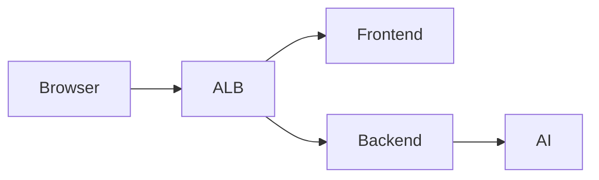

# Circini Migration Agent — AWS Deployment Guide (HNZ)

Prepared for Healthcare New Zealand · November 3, 2026 · Updated edition

The Circini Migration Agent is an AI assistant for DBT and SQL data migration. Analysts upload mapping and template documents into a chat interface, and a graph of specialised agents reads them, asks for missing information and generates Snowflake-compatible DBT models. This guide covers deploying the application into an HNZ-owned AWS account and operating it afterwards.

## About the application

An analyst uploads the template and mapping documents, answers the agents’ questions, and receives staging and transformation models to review, download and commit. The agents also answer lineage and change-impact questions using the evidence available to them.

| Aspect | Detail |
|---|---|
| Users | Migration analysts and data engineers: admin, analyst and auditor roles |
| Interface | Browser chat, file uploads, live Socket.IO progress and downloadable SQL |
| Agents | LangGraph turn graph with clarification and resume behaviour |
| Model in reference deployment | GPT-OSS 120B on AWS Bedrock in ap-southeast-2 |
| Evidence sources | Uploads and saved chats; optional repository and data-platform integrations |
| Output | Snowflake-compatible DBT staging and transformation models |
| Clinical data | Outside approved scope; PHI and voice modes cannot be enabled |

This edition preserves the original HNZ guide’s structure and updates its technical content from the November 3 audit. Eight of nine functional checks passed; the full My Files workflow remains unverified.

<!-- pagebreak -->

## Scope of this guide

This guide is for the cloud engineer deploying and operating the Migration Agent in an HNZ-owned AWS account. The manual steps use the AWS CLI and do not require GitHub Actions. A separate section explains the implemented pipeline.

The application runs as three containers: a React frontend, a Node/Express API that owns authentication and the application database, and a Python/FastAPI service that runs the agents. The load balancer routes requests to the frontend and backend. The AI service is private.

**CloudFormation is used.** Four core stacks create the network, data, identity and application resources. A fifth stack implements business hours. GitHub OIDC and testing have additional stacks in the reference environment. ECR repositories are provisioned separately.

## What has actually been verified

The reference deployment is in account **026146807914**, region **ap-southeast-2**, at **migration-agent.uat.signify.net.nz**. It is evidence for the existing reference environment; it does not certify an HNZ-owned deployment.

| Area | November 3, 2026 evidence |
|---|---|
| Application release | All three services use sha-c491105; each had one healthy running task |
| Infrastructure | Four core CloudFormation stacks complete; schedule and OIDC stacks also present |
| Identity | Cognito with administrator invitations and mandatory TOTP MFA |
| Functional verification | Eight checks passed; My Files check failed |
| External processing | OpenAI embeddings and LangSmith trace export enabled |
| Operational gaps | ECR tags mutable; SNS alert topic has no subscribers; log retention unset |

This is a dated snapshot. It is not a continuous availability guarantee. The earlier Keycloak architecture and unresolved IaC choice are superseded. Commands below describe a new HNZ deployment, with explicit Bedrock settings and LangSmith export disabled.

<!-- pagebreak -->

## At a glance

<!-- pdf-diagram: aws-topology -->


Deployed reference topology — public, application and data subnets.

The backend reaches the AI service through ECS Service Connect, using an internal key. There is no public AI listener rule. Outbound provider traffic uses the single NAT gateway. OpenAI embeddings and LangSmith traces are external destinations in the audited deployment; the HNZ example explicitly disables LangSmith.

<!-- pagebreak -->

## Before you start

Prepare these items before the first stack is created. Review fixed circini-* names for collisions if the AWS account is not dedicated to this application.

| Prerequisite | Detail |
|---|---|
| AWS account and region | An HNZ-controlled account and an approved region; examples use ap-southeast-2 (Sydney) |
| Operator identity | Permission to manage template resources, create named IAM roles and pass task roles; PowerUserAccess alone is insufficient |
| ECR repositories | circini-frontend, circini-backend and circini-ai-service; core templates do not create them |
| DNS | Authority to create the application record and ACM validation records |
| ACM certificate | An issued public certificate for the application hostname, in the ALB’s region |
| Bedrock | Approved access to openai.gpt-oss-120b-1:0 in the target region, plus the supported bearer-key configuration |
| OpenAI | A separate API key and approval for the embedding data path |
| Tools | AWS CLI v2, Git, Docker Buildx, Node 20+ and Python 3 with the operational scripts’ dependencies |
| Repository | small_migration; templates in deploy/aws and Dockerfiles in services |

### Permissions the operator identity needs

Use deploy/aws/github-oidc.yaml as the implemented policy reference. It covers CloudFormation, networking, RDS, ECS, load balancing, Cognito, logs, service discovery and related storage/identity resources. Review its broad service permissions with the account owner. Do not treat this guide as a substitute for that policy.

For a later GitHub Actions deployment, bootstrap the OIDC template with the HNZ organisation and repository. Use ExistingProviderArn if the AWS account already has a GitHub OIDC provider.

<!-- pagebreak -->

## Deploy from zero

Run the commands in Bash from the **repository root**. Replace example values before executing them. Network, data and Cognito must complete before the application stack can resolve their exports. Re-running an unchanged stack with the shown flag is a no-op.

Set these once in your shell:

```bash
export AWS_REGION=ap-southeast-2
export AWS_DEFAULT_REGION="$AWS_REGION"
aws sts get-caller-identity
export ACCOUNT_ID=$(aws sts get-caller-identity --query Account --output text)
export REGISTRY="$ACCOUNT_ID.dkr.ecr.$AWS_REGION.amazonaws.com"
export APP_DOMAIN=circini.example.health.nz
export TAG="sha-$(git rev-parse --short=7 HEAD)"
```

### 1. Request the TLS certificate first

Create the DNS validation record returned by ACM, then wait for the certificate to be issued. Start early: validation depends on DNS. The certificate must be in the ALB’s region.

```bash
export CERTIFICATE_ARN=$(aws acm request-certificate \
  --domain-name "$APP_DOMAIN" --validation-method DNS \
  --query CertificateArn --output text)
aws acm describe-certificate --certificate-arn "$CERTIFICATE_ARN" \
  --query 'Certificate.DomainValidationOptions[].ResourceRecord'
# Add the returned CNAME to the authoritative DNS zone, then:
aws acm wait certificate-validated --certificate-arn "$CERTIFICATE_ARN"
```

The application template supports HTTP when no certificate is supplied. The HNZ procedure uses HTTPS and a matching Cognito application origin.

<!-- pagebreak -->

### 2. Create the three ECR repositories

Create these once in a new account. For existing repositories, inspect their configuration first.

```bash
for service in frontend backend ai-service; do
  aws ecr create-repository --repository-name "circini-$service" \
    --image-scanning-configuration scanOnPush=true \
    --image-tag-mutability IMMUTABLE
done
```

These commands request immutable tags for HNZ. **The audited reference repositories are MUTABLE**, with scan-on-push enabled. Commit-shaped tags alone do not prevent overwrite. Record and check image digests before relying on rollback tags.

### 3. Build and push the images

The task definitions do not set RuntimePlatform. Build linux/amd64 images, including on an ARM laptop. Generate the frontend’s API documentation before the image build.

```bash
aws ecr get-login-password | docker login \
  --username AWS --password-stdin "$REGISTRY"
node services/frontend/scripts/prepare-api-docs.mjs
for service in frontend backend ai-service; do
  docker buildx build --platform linux/amd64 \
    -t "$REGISTRY/circini-$service:$TAG" \
    -f "services/$service/Dockerfile" "services/$service" --push
done
```

Manual builds do not automatically run CI security checks or evaluations. Complete the repository’s release checks before using these images.

<!-- pagebreak -->

### 4. Network stack

The network is VPC 10.20.0.0/16 with two public, two application and two data subnets across two availability zones, one NAT gateway and three security groups. The ALB spans two AZs. Application tasks were observed in both AZs; the database remains single-AZ.

```bash
aws cloudformation deploy --stack-name circini-network \
  --template-file deploy/aws/network.yaml --no-fail-on-empty-changeset
```

### 5. Data and identity stacks

The data stack creates private RDS PostgreSQL 16 and eleven Secrets Manager records. The reference database runs engine 16.13 on db.t4g.small, with 20 GiB encrypted storage and seven-day automated backups. Multi-AZ and deletion protection were both off at audit time.

The Cognito stack creates the pool, three groups, SPA client and hosted domain. Use the final HTTPS origin and an HNZ administrator address.

```bash
aws cloudformation deploy --stack-name circini-data \
  --template-file deploy/aws/data.yaml --no-fail-on-empty-changeset \
  --parameter-overrides SeedAdminEmail=circini-admin@example.health.nz
aws cloudformation deploy --stack-name circini-cognito \
  --template-file deploy/aws/cognito.yaml --no-fail-on-empty-changeset \
  --parameter-overrides AppUrl="https://$APP_DOMAIN"
```

The seed-admin secret is unused under OIDC authentication. The first administrator must be created in Cognito, as described in First run.

<!-- pagebreak -->

## Secrets

The data stack creates the following records under circini/. Populate the required provider values **before deploying the application**. Secret values are injected into container environment variables when a task starts.

| Secret suffix | Value and use |
|---|---|
| db-master | Generated database credentials |
| database-url | Assembled database connection string |
| jwt-secret | Generated signing material |
| internal-api-key | Generated backend-to-AI authentication key |
| integration-encryption-key | Generated encryption material for stored integration credentials |
| seed-admin | Generated local-auth administrator record; unused with OIDC |
| bedrock-api-key | Operator-supplied bearer key; required for this Bedrock route |
| openai-api-key | Operator-supplied key; required for OpenAI embeddings |
| github-oauth | Operator-supplied GitHub App JSON, if enabled |
| gitlab-oauth | Operator-supplied OAuth JSON, if enabled |
| azure-openai-api-key | Operator-supplied key, only for an Azure route |

Use protected files outside the repository. Each provider-key file must contain only the key, without an unintended trailing newline. Remove temporary copies after secure provisioning.

```bash
aws secretsmanager put-secret-value --secret-id circini/bedrock-api-key \
  --secret-string file:///secure/path/bedrock-key.txt >/dev/null
aws secretsmanager put-secret-value --secret-id circini/openai-api-key \
  --secret-string file:///secure/path/openai-key.txt >/dev/null
```

The live audit confirmed the eleven core records and an optional LangSmith secret by metadata only. It did not retrieve secret values or validate every integration credential.

<!-- pagebreak -->

### 6. Application stack

The application stack creates the ECS cluster and Service Connect namespace, ALB, four task families, three application services, IAM roles, storage for audit/checkpoints, two DynamoDB tables, logs and alarms.

Pass identity, hostname and provider parameters explicitly. This HNZ example selects Bedrock and disables LangSmith trace export.

```bash
aws cloudformation deploy --stack-name circini-app \
  --template-file deploy/aws/app.yaml \
  --capabilities CAPABILITY_NAMED_IAM --no-fail-on-empty-changeset \
  --parameter-overrides \
    ImageTag="$TAG" AuthMode=oidc \
    AppDomain="$APP_DOMAIN" CertificateArn="$CERTIFICATE_ARN" \
    LlmProvider=bedrock BedrockRegion="$AWS_REGION" \
    BedrockModel=openai.gpt-oss-120b-1:0 \
    ApprovedLlmHost="bedrock-runtime.$AWS_REGION.amazonaws.com" \
    ProcessingRegion="$AWS_REGION" LangSmithSecretArn=''
```

AuthMode defaults to local in the template, LlmProvider to openai, and ProcessingRegion to unverified. The image default is stale. A bare template deployment does not select the HNZ configuration.

The AI service validates the provider, model, region, endpoint and bearer-key configuration at startup. A mismatch can prevent it starting. The accepted Bedrock model is openai.gpt-oss-120b-1:0.

### Stack reference

| Stack | Template | Purpose |
|---|---|---|
| circini-network | network.yaml | Network, routing and security groups |
| circini-data | data.yaml | RDS and eleven core secret records |
| circini-cognito | cognito.yaml | Identity, groups and SPA client |
| circini-app | app.yaml | Application, load balancer, storage and alarms |
| circini-business-hours | business-hours.yaml | Optional for manual deployment; installed by the standard pipeline |

Templates are under deploy/aws. GitHub OIDC is a separate bootstrap stack. The testing stack in the reference account is separate from the three production services.

<!-- pagebreak -->

## First run

Apply the schema, replace the application tasks, point DNS to the ALB and create the first administrator.

### 7. Apply the database schema

The health endpoint is database-independent. Healthy targets do not prove the schema exists. Run the standalone schema task and require exit code 0. It uses Prisma db push, which converges the schema rather than replaying versioned migrations; review changes and backups before applying it to existing data.

```bash
export APP_SUBNETS=$(aws cloudformation list-exports \
  --query "Exports[?Name=='circini-AppSubnets'].Value" --output text)
export APP_SG=$(aws cloudformation list-exports \
  --query "Exports[?Name=='circini-SgApp'].Value" --output text)
export SCHEMA_TASK=$(aws ecs run-task \
  --cluster circini-demo --launch-type FARGATE \
  --task-definition circini-schema-sync \
  --network-configuration \
  "awsvpcConfiguration={subnets=[$APP_SUBNETS],securityGroups=[$APP_SG],assignPublicIp=DISABLED}" \
  --query 'tasks[0].taskArn' --output text)
aws ecs wait tasks-stopped --cluster circini-demo --tasks "$SCHEMA_TASK"
export SCHEMA_EXIT=$(aws ecs describe-tasks --cluster circini-demo \
  --tasks "$SCHEMA_TASK" \
  --query "tasks[0].containers[?name=='schema-sync'].exitCode" --output text)
[ "$SCHEMA_EXIT" = 0 ] || { echo 'Schema task failed'; exit 1; }
```

If run-task returns no valid task ARN, inspect its failures before waiting. For a nonzero schema exit, inspect the schema-sync stream in /ecs/circini and resolve the cause before continuing.

### 8. Roll the services

```bash
for service in backend ai-service frontend; do
  aws ecs update-service --cluster circini-demo --service "$service" \
    --force-new-deployment >/dev/null
done
python3 scripts/wait-production-stable.py
```

The steady-state helper uses the repository’s circini resource conventions. Keep it aligned with any renamed resources in the HNZ account.

<!-- pagebreak -->

### 9. Point DNS at the ALB

Read the ALB DNS name and create a CNAME for the HNZ application subdomain. Route 53 can use an ALB alias record instead.

```bash
aws cloudformation describe-stacks --stack-name circini-app \
  --query "Stacks[0].Outputs[?OutputKey=='AlbDnsName'].OutputValue" \
  --output text
```

```bash
curl -fsS -o /dev/null "https://$APP_DOMAIN/"
curl -fsS "https://$APP_DOMAIN/api/health"
```

### 10. Create the first admin

Self-signup is disabled. Administrative Cognito group membership grants the application role. The seed-admin password does not provide an OIDC login.

```bash
export USER_POOL_ID=$(aws cloudformation list-exports \
  --query "Exports[?Name=='circini-UserPoolId'].Value" --output text)
export ADMIN_EMAIL=circini-admin@example.health.nz
aws cognito-idp admin-create-user --user-pool-id "$USER_POOL_ID" \
  --username "$ADMIN_EMAIL" \
  --user-attributes Name=email,Value="$ADMIN_EMAIL" \
    Name=email_verified,Value=true >/dev/null
aws cognito-idp admin-add-user-to-group --user-pool-id "$USER_POOL_ID" \
  --username "$ADMIN_EMAIL" --group-name admin
```

At first login the user completes password setup and TOTP enrolment. Verify email delivery and the complete interactive login in the HNZ account; the reference audit checked configuration, not a human MFA session.

The live client and template retain localhost callback/logout URLs. Review them before HNZ production use. The current backend also supports administrator-triggered Cognito email invitations. Review the sender configuration and any required SES identity before handover.

<!-- pagebreak -->

## Verification

The November 3 reference run completed **eight passing checks and one failing check** against release sha-c491105. This is not an all-green release certification.

| Verification check | Fresh result |
|---|---|
| Public and AWS security smoke | PASS: 19 assertions; independent public probe also passed 16 assertions |
| GitHub integration boundaries | PASS: connection initiation, signed/unsigned webhook handling, callback and anonymous-access checks |
| Agent/tool APIs | PASS: 15 agents, 12 tools, upload/download, session isolation, source grants, auditing and revocation |
| Chat-history and file search | PASS: semantic search, cross-chat recall, follow-up and file delivery |
| Feedback rubric | PASS: persistence, aggregate/filter and score-clearing behavior |
| Impact analysis | PASS: Bedrock GPT-OSS, explicit source grants, grounded report and read-only scope |
| SQL-generation graph | PASS: clarification pause/resume, generation, structured drafts, macro revision and metering |
| Long-term memory | PASS: cross-chat recall, explicit erasure and synthetic-fixture cleanup |
| My Files / file library | FAIL: initial cross-chat reference check; targeted rerun failed at generated-output discovery |
### My Files remains an open validation issue

The first run failed at reuse of an exact uploaded SQL version in another chat. A targeted rerun passed that phase, then failed because expected generated SQL was not discoverable in My Files. Upload version creation and preservation passed.

The assertion “Generated output was not indexed in My Files” does not establish whether generation, indexing or the test expectation caused the absence. Later output-versioning and reuse assertions were not reached. No application fix was deployed as part of the audit.

<!-- pagebreak -->

### Verify the HNZ deployment itself

Capture the target account, region, stack statuses, image tags and digests, task revisions and provider configuration. Probe the public hostname, then test login/MFA, role restrictions, a non-clinical chat, uploads/search, SQL generation, download, audit delivery and alert routing.

```bash
aws cloudformation describe-stacks \
  --query 'Stacks[].{Stack:StackName,Status:StackStatus}' --output table
aws ecs describe-services --cluster circini-demo \
  --services frontend backend ai-service \
  --query 'services[].{Name:serviceName,Running:runningCount,Desired:desiredCount}' \
  --output table
curl --fail --silent --show-error "https://$APP_DOMAIN/" -o /dev/null
curl --fail --silent --show-error "https://$APP_DOMAIN/api/health"
```

The scripts under scripts/verify-*-production.py create synthetic fixtures and launch AWS tasks; model calls may incur usage charges. Inspect their target settings before use in HNZ. Set EXPECTED_LLM_PROVIDER=bedrock and EXPECTED_LLM_MODEL=openai.gpt-oss-120b-1:0 for the Bedrock graph/impact checks. Some defaults still refer to the reference environment or OpenAI.

### What the reference audit did not prove

The deployment role could not read WAF association or Bedrock invocation-logging configuration. Those controls remain unverified. Missing template resources do not prove that an account-wide control is absent.

Interactive Cognito login, email/alert delivery, backup restoration, disaster recovery, provider retention approvals, connected Snowflake/dbt Cloud/GitLab operations and receipt of LangSmith/OTel exports were not proven. The provider-approval reference parameter was empty.

Tests used short-lived API credentials and synthetic fixtures. The final status check confirmed maintenance leases released, public access open and all three services healthy. These are November 3 observations.

<!-- pagebreak -->

## Day-2 runbook

### Release a new version

Build release-specific images, reapply the application stack with the full approved parameter set, run the schema step when needed, replace tasks and repeat verification. Keep provider and identity settings explicit.

```bash
export TAG="sha-$(git rev-parse --short=7 HEAD)"
# Build and push all three images (step 3).
# Deploy the app with approved parameters (step 6).
# Run schema-sync (step 7), then replace tasks (step 8).
```

### Roll back

First check the recorded digest of the known-good image: tags in the reference repositories are mutable. Reapply step 6 with that verified tag and the same approved provider, identity and domain parameters, then repeat the task replacement and checks.

An image rollback does not reverse a database schema change. Confirm compatibility before proceeding. There is no ECS deployment circuit breaker defined; a failing rollout needs operator diagnosis and explicit recovery. MinimumHealthyPercent=100 and MaximumPercent=200 allow replacement tasks to start while healthy old tasks remain, but do not guarantee service availability during every failure.

### Logs

Container output is in /ecs/circini, with backend, ai-service, frontend, schema-sync and init-* stream prefixes.

```bash
aws logs tail /ecs/circini --follow --format short
aws logs tail /ecs/circini \
  --log-stream-name-prefix backend --since 30m
```

The audited log group has no retention period. Set an approved policy rather than assuming automatic deletion. Application activity, database audit records, S3 archives and provider retention have separate lifecycles.

<!-- pagebreak -->

### Alarms — subscribe to them

The audited deployment has five alarms in OK state. The circini-security-alerts topic has **zero confirmed and zero pending subscribers**, so it has no recipient to notify. Subscribe the approved operations address and confirm receipt of the subscription and a test notification.

```bash
export TOPIC_ARN=$(aws cloudformation describe-stacks \
  --stack-name circini-app \
  --query "Stacks[0].Outputs[?OutputKey=='SecurityAlertTopicArn'].OutputValue" \
  --output text)
aws sns subscribe --topic-arn "$TOPIC_ARN" --protocol email \
  --notification-endpoint "$ALERT_EMAIL"
```

Set ALERT_EMAIL to the HNZ-approved distribution list first. A successful subscription request alone does not prove confirmation or delivery.

### User administration

Use Cognito to manage users and admin, analyst or auditor group membership. Set USER_EMAIL to the account being administered.

```bash
aws cognito-idp list-users --user-pool-id "$USER_POOL_ID"
aws cognito-idp admin-list-groups-for-user \
  --user-pool-id "$USER_POOL_ID" --username "$USER_EMAIL"
# Offboard a user:
aws cognito-idp admin-disable-user \
  --user-pool-id "$USER_POOL_ID" --username "$USER_EMAIL"
aws cognito-idp admin-user-global-sign-out \
  --user-pool-id "$USER_POOL_ID" --username "$USER_EMAIL"
```

Do not assume these operations immediately invalidate locally verified JWTs at every application component. Account for the five-minute access-token lifetime and verify session behaviour during offboarding.

### Rotating a secret

Write the replacement using the protected-file pattern in Secrets, then force a new deployment of the affected services. Tasks retain values injected at startup. Coordinate database password changes with database-url; an unchanged stack redeploy is not proof that the connection string refreshed.

<!-- pagebreak -->

### Business-hours schedule

The controller uses Pacific/Auckland weekdays, with public hours 08:30–19:00, earlier RDS/task startup and compute scale-down outside the window. It follows the configured timezone but has no public-holiday calendar. The matching listener gate returns HTTP 503 during closed hours, affecting API callers and webhooks too.

The manual route in this guide does not install the schedule. **The standard GitHub deployment workflow installs it unconditionally.** For 24/7 operation, change that workflow behaviour and reconcile any existing schedule and gate.

The template hardcodes migration-agent.uat.signify.net.nz in the gate’s host condition. Change it to HNZ’s hostname. Use the helper to compile and deploy the controller; do not deploy its raw template without compilation.

```bash
python3 scripts/deploy-business-hours.py
python3 scripts/manage-business-hours.py status
python3 scripts/manage-business-hours.py hold \
  --owner hnz-maintenance --wait
# Complete maintenance and verification, then release:
python3 scripts/manage-business-hours.py release \
  --owner hnz-maintenance
```

Maintenance leases are bounded to a maximum three-hour window. Always release the lease after the work and check final public availability.

### GitHub Actions deployment route

.github/workflows/deploy.yml assumes the deployment role through GitHub OIDC. Bootstrap github-oidc.yaml with HNZ’s organisation/repository and configure AWS_DEPLOY_ROLE_ARN, AWS_REGION, APP_DOMAIN, CERTIFICATE_ARN and AUTH_MODE=oidc.

Set LLM_PROVIDER=bedrock, BEDROCK_REGION, BEDROCK_MODEL, APPROVED_LLM_HOST and PROCESSING_REGION explicitly. The workflow’s provider fallback is OpenAI. Disable/remove its LangSmith-key path when export is not approved.

The pipeline gates on CI/evaluations, builds images, applies stacks, preflights configuration, runs schema-sync, replaces tasks, runs smoke/functional checks and reconciles the schedule. Manual deployment does not demonstrate those pipeline gates passed.

<!-- pagebreak -->

## Security and data residency

Use approved non-clinical migration material only. PHI and voice modes are unavailable: the AI service rejects PHI_MODE=true, voice enablement and disabled guardrails at startup. Health-PII detection is a technical safeguard, not proof that every sensitive input is detected or approval to process patient records.

The reference deployment stores AWS application data in ap-southeast-2, Sydney. If HNZ requires another jurisdiction, assess service/model availability and region-specific configuration before deployment. Validate any alternative region against HNZ requirements and the application’s supported services.

### Where data actually goes

| Destination | Data path in the audited deployment |
|---|---|
| AWS ap-southeast-2 | RDS data, S3 audit/checkpoint objects, DynamoDB state/memory and CloudWatch logs |
| Bedrock regional endpoint | Chat inference using GPT-OSS 120B |
| api.openai.com | Text used for file-search embeddings; a separate external processing path |
| api.smith.langchain.com | Agent trace export enabled by AGENT_TRACING_ENABLED=true; receipt was not independently verified |

A Bedrock model selection does not establish an AWS-only or region-only data boundary. Provider endpoint names alone do not prove the contractual processing location or retention terms. Confirm those separately.

### HNZ provider settings

The deployment example sets LangSmithSecretArn='' explicitly. On an existing stack, omitting the parameter can preserve its previous value, so omission is not a reliable disable operation.

OpenAI embeddings remain enabled in the example. Obtain approval for that path or change the implementation/configuration. Clearing EMBEDDING_PROVIDER on the Bedrock path disables the supported semantic-search route; it does not move embeddings to Bedrock. Re-test affected workflows before handover.

<!-- pagebreak -->

### Controls in the implementation

| Layer | Implemented configuration and limits |
|---|---|
| Identity | Cognito, administrator-only signup, TOTP MFA, three groups, five-minute access tokens and 30-day refresh tokens |
| Network | Private tasks and database; ALB public; database port 5432 restricted to the application security group |
| Egress | Single NAT; application security group allows all outbound protocols to 0.0.0.0/0. Application host checks are not a network allowlist |
| Transport | HTTP redirects to HTTPS; live ALB uses TLS 1.3/1.2 policy; certificate was valid |
| Containers | Read-only application roots and required writable mounts; root volume-init containers are an intentional exception |
| Secrets | Secrets Manager injection at task start; describe-only metadata was used during audit |
| Encryption | Encrypted RDS and AES256 S3; confirm any HNZ customer-managed-key requirements separately |
| Audit archive | S3 versioning, public-access block and Object Lock enabled; application requests per-object legal holds |
| Supply chain | ECR scanning enabled; live tags mutable; ADOT collector image uses latest |

### Retention is separate for each store

Application code retains chats, uploads, outputs, AI activity, usage and audits indefinitely, with automaticDeletion=false. The memory table had no TTL. The checkpoint table had TTL enabled; checkpoint S3 rules expire tagged objects at 30 days and globally at 35 days.

These checkpoint policies do not delete application database records. The audit bucket has no lifecycle policy; individual stored-object holds were not inspected. CloudWatch retention was unset. Provider retention and export destinations require their own review.

### Controls requiring follow-up

ALB access logging was off, RDS deletion protection was off and backup restoration was not tested. WAF association and Bedrock invocation logging were inaccessible to the audit role. Verify those through an authorised operator before claiming they are present or absent.

<!-- pagebreak -->

## Constraints and gotchas

| Constraint | What to do |
|---|---|
| ECR repositories are not created by the core templates | Provision three repositories first; check mutability and record digests |
| No explicit RuntimePlatform | Build linux/amd64, including from ARM laptops |
| Demo-oriented template defaults | Pass HNZ hostname, identity, image and provider parameters explicitly |
| Database-independent /api/health | Run schema-sync and functional checks before declaring the application usable |
| Public /ai/health returns SPA HTML | HTTP 200 there is not private AI health; use runtime and backend-mediated tests |
| seed-admin unused under OIDC | Bootstrap the administrator through Cognito group membership |
| Prisma db push | Review schema changes and backup/compatibility before executing |
| In-process Socket.IO state | Design shared state/adapter support before increasing backend replicas; retain target-group stickiness |
| ALB idle timeout is 660 seconds | Preserve sufficient time for long-running chat operations |
| Read-only roots depend on volume mounts | Keep writable paths configured; expect nonessential root init containers to exit after setup |
| Single-AZ RDS and one NAT | Agree availability and recovery requirements; two subnet AZs do not guarantee workload redundancy |
| No deployment circuit breaker | Monitor the rollout and recover explicitly to a compatible, known-good release |
| Hardcoded scheduler hostname | Change and validate the HNZ gate; remove/reconcile scheduling for 24/7 use |
| My Files check has not fully passed | Diagnose output discovery/repeatability and rerun the complete workflow |

Do not copy a historical cost, security or availability claim into an HNZ acceptance record without current target-account evidence.

<!-- pagebreak -->

## Cost

The original guide’s approximately USD 160/month estimate was based on earlier assumptions and is not a current quotation. The audited application tasks reserve a total of **1.25 vCPU and 4.5 GiB**: frontend 0.25 vCPU/512 MiB, backend 0.5 vCPU/2048 MiB and AI 0.5 vCPU/2048 MiB. Schema-sync is a separate one-off task.

Price the chosen HNZ region and service settings, model/embedding usage, logs, storage, backups, secrets, NAT/data transfer and load balancer. Business-hours operation reduces compute hours but leaves standing infrastructure and storage costs. No updated cost quotation was produced by the audit.

## Decisions for HNZ

| Decision | Required agreement |
|---|---|
| Region and residency | Approve the target region and all external processing paths; reassess templates and model availability for a different region |
| Data in scope | Approved non-clinical migration artefacts; patient-data use needs an independent assessment and changed boundary |
| Embeddings | Approve OpenAI processing or fund an alternative and re-test semantic-search workflows |
| Trace export | Keep explicitly disabled unless the destination and tenancy are approved |
| Availability | Choose business hours or 24/7; agree database/network redundancy |
| Identity | HNZ-owned hostname, initial administrator, user roles and verified invitation delivery |
| Retention and encryption | Agree policies per store, audit holds and any customer-managed keys |
| Monitoring | Name the alert recipient; confirm subscription and actual delivery |
| Backup and recovery | Agree RPO/RTO and perform a restore test |
| Feature acceptance | Resolve the My Files failure and complete the target-account acceptance checks |

Optional repository integration needs its own credentials and validation; an existing secret record alone is not evidence of a working connection.

<!-- pagebreak -->

## What we need back from HNZ

- Target AWS account, approved region and accountable infrastructure owner.
- Application hostname, DNS owner and certificate validation contact.
- Approved Bedrock access and secure provisioning of provider credentials.
- Privacy decision for OpenAI embeddings and any requested LangSmith export.
- Confirmation of approved non-clinical data scope.
- First administrator’s email, initial users/roles and invitation sender requirements.
- Operations alert distribution list and escalation owner.
- Business-hours or 24/7 decision, retention standards and recovery targets.
- Owners for the outstanding functional and control-verification work.

### Repository integration (optional)

For GitHub, the application supports a GitHub App with read-only Contents and Metadata access. Configure callback https://<APP_DOMAIN>/api/integrations/github/callback and webhook https://<APP_DOMAIN>/api/integrations/github/webhook.

The circini/github-oauth secret requires appId, slug, clientId, clientSecret, privateKey (complete PEM) and webhookSecret. Follow the current repository schema and secure provisioning procedures. The audit verified connection initiation and webhook security boundaries, not a complete user-authorised repository session.

## Where to look when something breaks

Start with ECS service events, then stopped-task reasons, then the relevant /ecs/circini log stream. Provider configuration, secret access, image architecture, writable mounts and private-subnet egress are common causes to inspect.

For HTTP 503, check business-hours state and ALB target health. For healthy targets with failed application actions, check schema completion, provider access, authentication and the functional test result.

Do not use the public /ai/health page as evidence of AI-service health. It returned the frontend HTML in the reference deployment. Verify the private service through ECS/runtime state and backend-mediated operations.

<!-- pagebreak -->

## Evidence and handover record

This edition uses repository commit **c49110508edf85ba802b52b27216d9e6403704f1** and the **November 3, 2026** reference audit. It reorganises the verified AWS guide into the supplied HNZ format. It does not represent a new application release or a fresh audit after that date.

| Evidence | Result / reference |
|---|---|
| AWS inventory | [Run 41578571636](https://github.com/shankasf/small_migration/actions/runs/41578571636): successful inventory |
| Runtime/configuration supplement | [Run 41578846233](https://github.com/shankasf/small_migration/actions/runs/41578846233) |
| Full functional run | [Run 41578529716](https://github.com/shankasf/small_migration/actions/runs/41578529716): eight checks passed, one failed |
| Targeted My Files diagnostic | [Run 41580128697](https://github.com/shankasf/small_migration/actions/runs/41580128697): generated output not discoverable |
| Final operational state | [Run 41580392064](https://github.com/shankasf/small_migration/actions/runs/41580392064): services healthy, access open, maintenance lease cleared |
| Repository CI | [Run 41578151583](https://github.com/shankasf/small_migration/actions/runs/41578151583): security, type/lint and policy checks passed |

### Code references

- .github/workflows/deploy.yml — actual build, stack, schema, rollout and verification route.
- deploy/aws/network.yaml, data.yaml, cognito.yaml, app.yaml — core resources and defaults.
- deploy/aws/github-oidc.yaml — deployer identity and policy.
- deploy/aws/business-hours.yaml and scripts/deploy-business-hours.py — scheduled gate and compiled deployment.
- services/ai-service/llm.py, config.py and routes/file_search.py — provider validation and embeddings.
- services/backend/src/services/retention.ts and audit.ts — application lifecycle and audit storage.
- scripts/verify-*-production.py — functional checks and their limits.

Before HNZ acceptance, attach the corresponding HNZ account evidence, record unresolved items with owners, and sign off the agreed operating and data boundaries.
